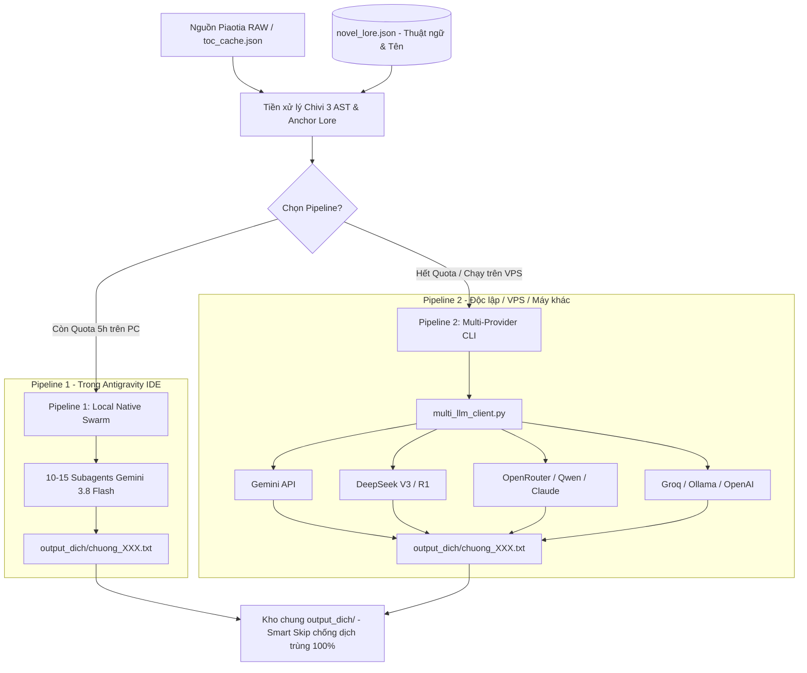

> CẬP NHẬT 2026-10-13: Hướng dẫn bên dưới là lịch sử. Lệnh batch/cache/ghi output_dich và tên model phải thay bằng QUALITY_WORKFLOW.md. Gói ZIP cũ chưa chứa cổng kiểm dịch; chưa dùng để chứng nhận chất lượng.

# HƯỚNG DẪN TRIỂN KHAI PIPELINE DỊCH TRUYỆN SANG MÁY KHÁC / VPS (HEADLESS)
**Tác phẩm:** 《没钱修什么仙？》 (Không Tiền Tu Cái Gì Tiên?) — Tác giả Hùng Lang Cẩu (熊狼狗)  
**Tài liệu kỹ thuật:** Vận hành độc lập đa nền tảng (Windows / Linux / macOS / Cloud VPS)

---

## MỤC LỤC
1. [Kiến trúc hệ thống & Cơ chế 2 Pipeline](#1-kiến-trúc-hệ-thống--cơ-chế-2-pipeline)
2. [Danh mục tệp cốt lõi cần thiết](#2-danh-mục-tệp-cốt-lõi-cần-thiết)
3. [Đóng gói 1-Click (Tự động nén file)](#3-đóng-gói-1-click-tự-động-nén-file)
4. [Hướng dẫn cài đặt trên Máy tính cá nhân (Windows / Mac)](#4-hướng-dẫn-cài-đặt-trên-máy-tính-cá-nhân-windows--mac)
5. [Hướng dẫn triển khai trên Cloud VPS / Linux Server (Headless)](#5-hướng-dẫn-triển-khai-trên-cloud-vps--linux-server-headless)
6. [Cấu hình nhà cung cấp AI trong `api_config.json`](#6-cấu-hình-nhà-cung-cấp-ai-trong-api_configjson)
7. [Bảng tra cứu lệnh CLI vận hành](#7-bảng-tra-cứu-lệnh-cli-vận-hành)
8. [Cơ chế Smart Skip & Đồng bộ hai chiều giữa các máy](#8-cơ-chế-smart-skip--đồng-bộ-hai-chiều-giữa-các-máy)
9. [Xử lý sự cố & Câu hỏi thường gặp (FAQ)](#9-xử-lý-sự-cố--câu-hỏi-thường-gặp-faq)

---

## 1. KIẾN TRÚC HỆ THỐNG & CƠ CHẾ 2 PIPELINE

Hệ thống được thiết kế theo mô hình **Module hóa hoàn toàn (Decoupled Architecture)**, cho phép bạn linh hoạt chuyển đổi giữa việc dùng máy cá nhân và máy chủ từ xa:



### So sánh tóm tắt 2 Pipeline:
- **Pipeline 1 (Local Native Subagents):** Dùng trực tiếp trong Antigravity IDE. Tận dụng Gemini 3.8 Flash nội tại với tốc độ cực cao (~10s/chương) và 0 đồng chi phí token ngoài, thích hợp khi còn quota 5h.
- **Pipeline 2 (Multi-Provider Portable CLI):** Dùng script Python thuần, chỉ cần RAM < 100MB, chạy tốt trên cả VPS 1GB RAM giá rẻ (hoặc Oracle Cloud Free Tier). Bạn tự do gắn key DeepSeek, OpenRouter, Gemini API hoặc server local.

---

## 2. DANH MỤC TỆP CỐT LÕI CẦN THIẾT

Khi chuyển sang máy tính khác hoặc máy chủ Cloud, bạn **chỉ cần đúng 9 tệp/thư mục sau** (tổng dung lượng < 200 KB code):

| STT | Tệp / Thư mục | Chức năng chi tiết |
|:---:|---|---|
| 1 | `pipeline_api.py` | Engine điều phối chính của Pipeline 2 (chia chunk, kiểm tra cache, gọi LLM, linter làm sạch bản dịch). |
| 2 | `multi_llm_client.py` | Bộ kết nối AI hợp nhất hỗ trợ Gemini, DeepSeek, OpenRouter, Groq, OpenAI (tự động retry, fallback model). |
| 3 | `prepare_for_agent.py` | Công cụ bóc tách cây ngữ pháp Chivi 3 AST (câu chữ 把, 被, trợ từ kết cấu 的) và khóa thực thể. |
| 4 | `get_toc.py` | Trình quản lý mục lục truyện (1,011 chương). |
| 5 | `toc_cache.json` | Cache danh mục toàn bộ 1,011 chương đã được lưu sẵn (giúp chạy offline / không bị nghẽn mạng). |
| 6 | `novel_lore.json` | Từ điển cốt lõi: tên nhân vật, địa danh, công pháp, trường phái, cấp bậc tu vi. |
| 7 | `api_config.json` | Tệp cấu hình các API keys, danh sách models ưu tiên, tham số retry và nhiệt độ. |
| 8 | `requirements.txt` | Danh sách thư viện phụ thuộc (`beautifulsoup4>=4.12.0`). |
| 9 | `output_dich/` *(Tùy chọn)* | Chứa các chương đã dịch (1 đến 81). Nếu chép kèm, máy mới sẽ tự động bỏ qua các chương này và làm tiếp từ chương 82. |

> [!NOTE]
> Các file lớn như `.pdf`, log cũ, hoặc mã nguồn nháp không cần mang theo để tiết kiệm thời gian truyền tải dữ liệu.

---

## 3. ĐÓNG GÓI 1-CLICK (TỰ ĐỘNG NÉN FILE)

Chúng tôi đã viết sẵn công cụ đóng gói tự động `package_project.py` trên máy nguồn:

### Cách 1: Chỉ đóng gói mã nguồn và từ điển (Rất nhẹ, ~50 KB)
```powershell
python package_project.py
```
Lệnh này sẽ tạo ra tệp `CaoTruyen_Deployment.zip`.

### Cách 2: Đóng gói cả các chương đã dịch từ 1 đến 81 (~1.5 MB)
```powershell
python package_project.py --include-output
```
Tất cả các chương đã hoàn thành trong thư mục `output_dich/` sẽ được nén cùng để máy mới không cần dịch lại.

---

## 4. HƯỚNG DẪN CÀI ĐẶT TRÊN MÁY TÍNH CÁ NHÂN (WINDOWS / MAC)

### Bước 1: Giải nén
Giải nén tệp `CaoTruyen_Deployment.zip` vào một thư mục bất kỳ trên máy mới (ví dụ: `D:\CaoTruyen` hoặc `~/CaoTruyen`).

### Bước 2: Cài đặt Python và thư viện
Yêu cầu Python 3.9 trở lên. Mở Terminal / PowerShell tại thư mục vừa giải nén:
```bash
# Tạo môi trường ảo (khuyến nghị)
python -m venv venv

# Kích hoạt môi trường ảo:
# Trên Windows PowerShell:
.\venv\Scripts\Activate.ps1
# Trên macOS / Linux:
source venv/bin/activate

# Cài đặt thư viện (chỉ 1 thư viện nhẹ):
pip install -r requirements.txt
```

### Bước 3: Điền API Key của bạn vào `api_config.json`
Mở `api_config.json` bằng Notepad hoặc VS Code, điền API Key của nhà cung cấp bạn muốn sử dụng (xem chi tiết ở Mục 6).

### Bước 4: Chạy thử nghiệm kiểm tra kết nối
```bash
python multi_llm_client.py
```
Nếu màn hình xuất hiện thông báo:
```text
[*] Kiểm tra kết nối AI Client theo api_config.json...
[gemini/gemini-flash-latest] -> Xin chào! Hệ thống Multi-Provider đã sẵn sàng!
```
Nghĩa là mọi cấu hình API đã chuẩn xác và sẵn sàng chạy!

---

## 5. HƯỚNG DẪN TRIỂN KHAI TRÊN CLOUD VPS / LINUX SERVER (HEADLESS)

Chạy trên Cloud VPS (ví dụ: Ubuntu/Debian trên Oracle Cloud Always Free 1GB RAM) là lựa chọn tối ưu để "treo máy" dịch tự động 24/7 mà không lo tốn điện hay gián đoạn mạng máy cá nhân.

### Bước 1: Cập nhật VPS và cài đặt môi trường
Đăng nhập SSH vào VPS:
```bash
sudo apt update && sudo apt install -y python3 python3-pip python3-venv git tmux
```

### Bước 2: Tải code lên VPS
Có 2 cách đưa file lên VPS:

**Cách A: Dùng SCP (Từ máy cá nhân)**
```powershell
# Chạy trên máy cá nhân
scp CaoTruyen_Deployment.zip user@<IP_VPS>:~/
```
Trên VPS, giải nén:
```bash
sudo apt install -y unzip
unzip CaoTruyen_Deployment.zip -d ~/CaoTruyen
cd ~/CaoTruyen
```

**Cách B: Sử dụng Git Repo riêng tư (Private Repo)**
Đẩy source code lên GitHub/GitLab rồi `git clone` trên VPS.

### Bước 3: Cài đặt dependencies trên VPS
```bash
cd ~/CaoTruyen
python3 -m venv venv
source venv/bin/activate
pip install -r requirements.txt
```

### Bước 4: Chạy ngầm bằng `tmux` (Chống ngắt kết nối khi tắt Terminal)
`tmux` giúp tiến trình tiếp tục chạy trên VPS ngay cả khi bạn tắt máy tính cá nhân hoặc mất mạng:

1. **Khởi tạo một session tmux:**
   ```bash
   tmux new -s dich_truyen
   ```

2. **Kích hoạt virtualenv và khởi chạy dịch:**
   ```bash
   source venv/bin/activate
   # Dịch từ chương 82 đến chương 200 dùng DeepSeek:
   python3 pipeline_api.py --from_chap 82 --to_chap 200 --provider deepseek
   ```

3. **Rời khỏi session (Detach) để treo ngầm:**
   Nhấn tổ hợp phím: `Ctrl + B`, sau đó nhấn tiếp phím `D`.  
   Bây giờ bạn có thể yên tâm đóng cửa sổ SSH, máy chủ sẽ tự động dịch ngầm liên tục!

4. **Quay lại session để xem tiến độ bất cứ lúc nào:**
   ```bash
   tmux attach -t dich_truyen
   ```

### Bước 5: Hoặc chạy bằng `nohup` (Nếu không quen dùng tmux)
```bash
nohup python3 pipeline_api.py --from_chap 82 --to_chap 300 > pipeline.log 2>&1 &
```
- **Theo dõi nhật ký chạy trong thời gian thực:**
  ```bash
  tail -f pipeline.log
  ```
- **Kiểm tra tiến trình:**
  ```bash
  ps aux | grep pipeline_api.py
  ```
- **Dừng tiến trình khi cần:**
  ```bash
  pkill -f pipeline_api.py
  ```

---

## 6. CẤU HÌNH NHÀ CUNG CẤP AI TRONG `api_config.json`

File `api_config.json` là trung tâm điều khiển cho phép bạn cắm bất kỳ AI nào vào hệ thống:

```json
{
  "active_provider": "gemini",
  "providers": {
    "gemini": {
      "description": "Google AI Studio API",
      "api_keys": [
        "AIzaSy..."
      ],
      "models": [
        "gemini-flash-latest",
        "gemini-flash-lite-latest",
        "gemini-3.1-flash-lite",
        "gemini-3.8-flash"
      ],
      "thinking_budget": 0,
      "temperature": 0.7
    },
    "deepseek": {
      "description": "DeepSeek Official API (Cực rẻ, văn phong kiếm hiệp đỉnh cao)",
      "api_key": "sk-xxxxxx",
      "base_url": "https://api.deepseek.com/v1",
      "models": [
        "deepseek-chat",
        "deepseek-reasoner"
      ],
      "temperature": 0.7
    },
    "openrouter": {
      "description": "OpenRouter (Đa nguồn: Qwen 2.5 72B, Claude 3.5, Gemini 2.0)",
      "api_key": "sk-or-v1-xxxxxx",
      "base_url": "https://openrouter.ai/api/v1",
      "models": [
        "deepseek/deepseek-chat",
        "qwen/qwen-2.5-72b-instruct"
      ],
      "temperature": 0.7
    },
    "custom_openai": {
      "description": "Groq Cloud / Together AI / Ollama Local",
      "api_key": "gsk_xxxxxx",
      "base_url": "https://api.groq.com/openai/v1",
      "models": [
        "llama-3.3-70b-versatile"
      ],
      "temperature": 0.7
    }
  },
  "settings": {
    "chunk_size_paragraphs": 60,
    "max_retries": 5,
    "request_delay_seconds": 1.0,
    "auto_fallback_provider": true
  }
}
```

### Các tùy chọn cấu hình quan trọng:
1. **`active_provider`**: Chọn provider mặc định sẽ chạy khi bạn không chỉ định cờ `--provider` trong câu lệnh CLI (`"gemini"`, `"deepseek"`, `"openrouter"`, hoặc `"custom_openai"`).
2. **`auto_fallback_provider`**: Nếu để `true`, khi provider chính hết tiền hoặc gặp lỗi, hệ thống sẽ tự động chuyển sang provider dự phòng tiếp theo trong danh sách mà không làm gián đoạn cả đợt dịch.
3. **`api_keys` (với Gemini)**: Hỗ trợ danh sách nhiều khóa (Array). Khi một key chạm ngưỡng Rate Limit ngày, hệ thống sẽ tự động đảo sang key kế tiếp.

---

## 7. BẢNG TRA CỨU LỆNH CLI VẬN HÀNH

Tất cả các thao tác đều được thực thi qua tệp [`pipeline_api.py`](pipeline_api.py):

| Mục đích thực hiện | Cú pháp câu lệnh |
|---|---|
| **Dịch 1 chương kiểm tra** | `python pipeline_api.py --chap 82` |
| **Dịch hàng loạt (theo dải chương)** | `python pipeline_api.py --from_chap 82 --to_chap 150` |
| **Chỉ định dùng DeepSeek API** | `python pipeline_api.py --from_chap 82 --to_chap 150 --provider deepseek` |
| **Chỉ định dùng OpenRouter** | `python pipeline_api.py --from_chap 82 --to_chap 150 --provider openrouter` |
| **Chỉ định dùng Gemini API** | `python pipeline_api.py --from_chap 82 --to_chap 150 --provider gemini` |
| **Bắt buộc dịch lại (bỏ qua cache)** | `python pipeline_api.py --chap 82 --force` |
| **Chuẩn bị nguyên liệu AST trước** | `python prepare_for_agent.py --from_chap 82 --to_chap 181` |

---

## 8. CƠ CHẾ SMART SKIP & ĐỒNG BỘ HAI CHIỀU GIỮA CÁC MÁY

### Nguyên lý Smart Skip:
Trước khi tải dữ liệu hay gửi yêu cầu tới LLM, `pipeline_api.py` sẽ thực hiện kiểm tra:
```python
if not force and os.path.exists(final_output_path) and os.path.getsize(final_output_path) > 1000:
    print(f"[*] [BỎ QUA] Chương {chap_num}: '{title}' đã có bản dịch hoàn chỉnh trên đĩa.")
    return True
```
- Nếu tệp bản dịch đã tồn tại trong thư mục `output_dich/` và dung lượng > 1KB, chương trình sẽ **bỏ qua ngay lập tức trong 0.01s**.
- **Ý nghĩa:** Bạn không bao giờ sợ bị trừ token 2 lần hay ghi đè lên các chương đã hoàn thành trước đó.

### Đồng bộ giữa PC và VPS:
Sau khi VPS chạy xong một loạt chương (ví dụ từ chương 82 đến 200), bạn có thể lấy bản dịch về máy chính bằng một dòng lệnh:

**Từ Windows PowerShell:**
```powershell
# Kéo toàn bộ thư mục output_dich từ VPS về máy cá nhân:
scp -r user@<IP_VPS>:~/CaoTruyen/output_dich/* I:\Softs\Antigravity\CaoTruyen\output_dich\
```
Hoặc dùng phần mềm giao diện trực quan như **WinSCP** hay **FileZilla** để kéo thả thư mục `output_dich/`.

---

## 9. XỬ LÝ SỰ CỐ & CÂU HỎI THƯỜNG GẶP (FAQ)

### Q1: Trang web gốc Piaotia có bị chặn IP hoặc trả về HTTP 429 không?
- **Trả lời:** Script `fetch_chapter_raw` đã tích hợp sẵn User-Agent trình duyệt hiện đại, cơ chế `ssl.CERT_NONE` và tự động dãn cách `time.sleep(0.3)`. Nếu trang nguồn bị nghẽn (HTTP 429 / 503), script sẽ tự động thử lại tối đa 5 lần với thời gian chờ tăng lũy tiến ($2s \rightarrow 4s \rightarrow 8s$).

### Q2: Nếu đang dịch giữa chừng một chương thì bị mất điện / rớt mạng?
- **Trả lời:** Hệ thống có cơ chế **Atomic Part Caching**. Mỗi chương được chia thành các phần nhỏ (~60 đoạn). Khi dịch xong phần nào, tệp cache `cache_chap_XXX/part_Y.txt` sẽ lập tức được ghi vào ổ đĩa. Khi bạn chạy lại câu lệnh, hệ thống sẽ nạp lại ngay các phần đã dịch từ đĩa (0s, 0 token) và chỉ dịch tiếp các phần còn dang dở.

### Q3: Muốn bổ sung tên nhân vật mới hoặc điều chỉnh thuật ngữ thì sửa ở đâu?
- **Trả lời:** Chỉ cần chỉnh sửa tệp [`novel_lore.json`](novel_lore.json). Bạn có thể thêm tên vào nhóm `"nhan_vat"` hoặc `"thuat_ngu"`. Ngay lập tức ở các chương tiếp theo, bộ bóc tách Chivi 3 AST sẽ tự động khóa cứng các danh xưng mới này trước khi đưa vào AI dịch.
