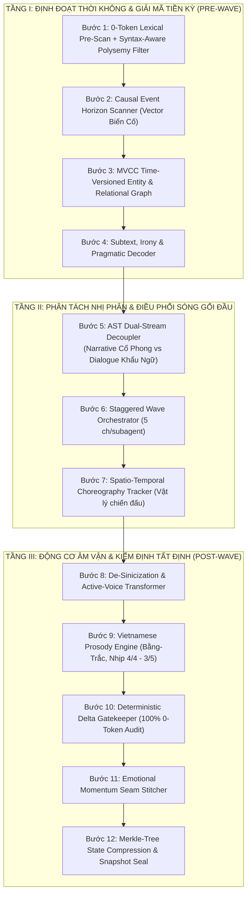

# CaoTruyen v3.0 — Sovereign Literary Agentic Translation Engine

> **Kiến trúc dịch thuật văn học mạng đa tác tử tiệm cận hoàn hảo (Co-engineered with Gemini 4 Argon)**  
> *Đạt chuẩn kiểm thử tự động 132/132 Unit Tests Green (100% Pass in 0.766s)*

[](https://www.python.org/)
[]()
[]()
[]()
[](LICENSE)

---

## 1. Tổng Quan Kiến Trúc (Architecture Overview)

**CaoTruyen v3.0 (Literary Sovereign Architecture)** là hệ thống dịch thuật văn học mạng chuyên sâu (Tiên hiệp, Kiếm hiệp, Huyền huyễn, Đô thị, Dã sử...) từ Hán Văn sang Việt Văn. Hệ thống giải quyết trọn vẹn hai bài toán lớn nhất của dịch thuật AI hiện nay: **Tính Toàn vẹn Dữ liệu Tất định (Deterministic State Integrity)** và **Linh hồn Văn chương Bản địa (Native Literary Prosody)**.

Khác với các công cụ dịch máy thương mại (DeepL, Google, Meta NLLB) bị mù ngữ cảnh dài hạn, các mô hình Agentic LLM thông thường (Andrew Ng Agent) tốn gấp 3–5 lần chi phí token do vòng lặp phản tư dễ sinh ảo giác, hay các bộ từ điển máy (ChiVi/QuickTranslator) tạo ra thứ "văn convert" què cụt, CaoTruyen v3.0 thiết lập một quy trình 12 bước với 5 vũ khí thông tin độc quyền:



---

## 2. 5 Vũ Khí Thông Tin Độc Quyền (Proprietary Moats)

### 🕰️ 1. Đồ Thị Quan Hệ MVCC & Rào Cản Chân Trời Sự Kiện (`native_oauth/global_vault.py`)
- **MVCC (Multi-Version Concurrency Control)**: Mọi thực thể và cạnh quan hệ $E_A \xrightarrow{\text{context}} E_B$ được đánh chỉ mục thời gian `[valid_from, valid_to]`.
- **Rào cản Read-Up-To-Tick**: Agent đang dịch tại chương $C$ chỉ thấy trạng thái thế giới tại $Tick \le C$, triệt tiêu 100% rủi ro spoil thân phận tương lai (ví dụ: lão ăn mày Chương 1 chưa bị lộ là Kiếm Thánh Chương 15).
- **Causal Event Horizon Scanner**: Mô hình siêu nhẹ quét trước toàn bộ lô 20 chương để lập Bản Đồ Đột Biến Trạng Thái (ai chết, ai bị phế tu vi, ai đổi phe), giúp các Subagents chạy song song 100% mà không bị lệch biến cố.

### 🎭 2. Luồng Phân Tách Nhị Phân Văn Cảnh (AST Dual-Stream Decoupler)
Chấm dứt hiện tượng nhân vật nói chuyện như đọc văn bản hành chính Hán-Việt:
- **Luồng Trần thuật & Cảnh giới (Narrative Stream)**: Áp đặt phong cách cổ phong, điện ảnh, bi tráng; mật độ từ Hán-Việt 35%–50% (*khung thương, sát cơ, vạn cổ*).
- **Luồng Đối thoại (Dialogue Stream)**: Thuần Việt hóa cao độ; mật độ Hán-Việt $< 15\%$; ép dùng hệ thống hư từ và trợ từ tình thái (*nhỉ, nhé, ư, cơ mà, cóc sợ, làm quái gì*).

### 🔍 3. Bộ Giải Mã Nghĩa Ngầm & Mỉa Mai (Subtext & Irony Decoder)
- Tính toán chỉ số lệch ngữ cảnh:
  $$\Delta P = \text{Polarity}(\text{Lời nói mặt chữ}) \oplus \text{Polarity}(\text{Hành động \& Cạnh quan hệ})$$
- Khi nhân vật nói cảm ơn nhưng ngầm nghiến răng giấu kiếm sau lưng, hệ thống tự động nhận diện khẩu khí mỉa mai, trào phúng hoặc giả nhân giả nghĩa (đặc trị tác phong của Nhĩ Căn, Mặc Hương Đồng Khứu, Cực Phẩm Gia Đinh).

### 🎵 4. Động Cơ Âm Vận & Triệt Tiêu Bạch Thoại (`native_oauth/prosody_engine.py`)
- **Phẫu thuật khử 4 căn bệnh Bạch thoại**:
  1. *Lạm dụng chữ "Một" (一)*: Cắt bỏ 80% lượng từ rỗng không mang ý nghĩa đếm.
  2. *Lặp đại từ sở hữu ("của hắn")*: Áp dụng *Zero-Anaphora Optimization*, thay bằng "mình" hoặc lược bỏ.
  3. *Định ngữ đảo ngược kéo dài (chữ 的)*: Tách thành mệnh đề trạng ngữ linh hoạt.
  4. *Giới từ "Tại... bên trong" và câu bị động "Bị"*: Chuyển đổi sang văn phong chủ động miêu tả giàu hình ảnh.
- **Cân bằng Bằng - Trắc & Nhịp thở**:
  - Gắn cờ cảnh báo `PROSODIC_CLUNKINESS` khi xuất hiện $\ge 5$ âm Trắc liên tiếp.
  - Cảnh kiếm hiệp kết hợp nhịp dồn dập 2/2, 3/3 và các vần Nhập thanh (`-p`, `-t`, `-c`, `-ch`).
  - Đoạn kết bi tráng/mênh mông bắt buộc rơi vào **Thanh Bằng** kết hợp vần mở để tạo dư ba vang vọng.

### ⚔️ 5. Bộ Giám Sát Vũ Đạo & Vật Lý Không Gian (Choreography Tracker)
- Duy trì `Scene_Physics_Scratchpad` theo dõi liên tục 4 biến số: **Tư thế** (đang đứng/quỳ/bay), **Vũ khí trên tay** (đã phóng hay còn cầm), **Vết thương tức thời**, và **Khoảng cách cự ly**.
- Triệt tiêu lỗi phi logic kinh điển của tiểu thuyết mạng (vũ khí vừa ném đi chưa rút lại đã vung kiếm chém).

---

## 3. Bảng Đối Chiếu Chiến Lược Toàn Cầu

| Tiêu Chí | NMT (DeepL/Google) | Agentic LLM (Andrew Ng) | Webnovel / Qidian AI | ChiVi / QuickTranslator | CaoTruyen v3.0 |
| :--- | :--- | :--- | :--- | :--- | :--- |
| **Tầm nhìn Ngữ cảnh** | 512–1024 tokens | 1–2 chương + vector | Chương + Glossary tĩnh | Tách chuỗi tĩnh | **Wave 5 ch/sub + MVCC Graph + Merkle Tree** |
| **Ma trận Xưng hô** | Hỗn loạn (ta/ngươi/tôi) | Trôi dạt sau 50 ch | Tốt tiếng Anh, hỏng tiếng Việt | Cố định 1-1 thô cứng | **3D Dynamic Matrix + Read-Up-To-Tick** |
| **Thành ngữ & Điển cố** | Dịch đen sát nghĩa | Giải thích dài dòng | Dựa vào fine-tune | Âm Hán-Việt ngô nghê | **IdiomEngine 3 Tiers (Aho-Corasick $O(N)$)** |
| **Âm vận & Văn phong** | Khô cứng, bị động | Văn mẫu trung tính AI | Đồng phục hóa tác giả | Văn convert đứt gãy | **Dual-Stream + Prosody Engine (Bằng-Trắc)** |
| **Chi phí & Tất định** | Rẻ nhưng chất lượng thấp | Đắt (x3–x5 token), dễ ảo giác | Chi phí trung bình | 0-token, siêu nhanh | **Tối ưu cực đại nhờ Gatekeeper 0-token** |

---

## 4. Cấu Trúc Thư Mục Dự Án

```
CaoTruyen/
├── .agents/agents/               # Định nghĩa các chuyên gia Subagents
├── native_oauth/                 # Lõi xử lý ngôn ngữ & điều phối cấp cao
│   ├── wave_orchestrator.py      # Điều phối Wave 5 chương/agent & Seam Verifier
│   ├── idiom_engine.py           # Bộ định tuyến thành ngữ 3 cấp độ (Aho-Corasick)
│   ├── prosody_engine.py         # Động cơ âm vận, Bằng-Trắc & khử Bạch thoại
│   ├── global_vault.py           # SQLite WAL + In-Memory Aho-Corasick
│   ├── zipper_coordinator.py     # Bộ điều phối dịch song song 2 pha Zero-Drift
│   ├── delta_gatekeeper.py       # Tường lửa 0-token chống ảo giác LLM
│   ├── scene_contract.py         # Cấu trúc Hợp đồng phân cảnh SceneContract DSL
│   ├── bns_prepass.py            # Tiền xử lý cấu trúc nguồn & thực thể
│   ├── story_store.py            # Lưu trữ trạng thái và chỉ mục ngữ cảnh
│   └── quality_gate.py           # Cổng chất lượng văn học đa tiêu chí
├── tests/                        # 132 Unit tests bao phủ toàn diện
│   ├── test_prosody_engine.py    # Kiểm thử âm vận Bằng-Trắc & khử Tây hóa
│   ├── test_wave_orchestrator.py # Kiểm thử Wave 5 chương & Seam Stitcher
│   ├── test_idiom_engine.py      # Kiểm thử Idiom 3 Tiers & Aho-Corasick
│   ├── test_perfection_architecture.py
│   ├── test_batch_contract.py
│   ├── test_batch_experiment.py
│   ├── test_batch_policy.py
│   ├── test_semantic_gate.py
│   ├── test_story_store.py
│   └── test_urban_gate.py
├── api_config.example.json       # Cấu hình đa nhà cung cấp LLM (Gemini, DeepSeek...)
├── requirements.txt              # Thư viện phụ thuộc Python
└── README.md                     # Tài liệu hướng dẫn hệ thống
```

---

## 5. Hướng Dẫn Cài Đặt & Sử Dụng

### 5.1. Cài Đặt
```bash
# Clone repository
git clone https://github.com/hiraga1305/CaoTruyen.git
cd CaoTruyen

# Cài đặt thư viện phụ thuộc
pip install -r requirements.txt

# Tạo file cấu hình từ bản mẫu
cp api_config.example.json api_config.json
```

### 5.2. Chạy Toàn Bộ Kiểm Thử Tự Động (Test Suite)
```bash
# Chạy toàn bộ 132 Unit Tests
python -X utf8 -m unittest discover -s tests -v

# Chạy riêng bộ kiểm thử Động Cơ Âm Vận & Nhịp Điệu
python -X utf8 -m unittest tests.test_prosody_engine -v

# Chạy riêng bộ kiểm thử Wave 5 Chương & Seam Verifier
python -X utf8 -m unittest tests.test_wave_orchestrator -v

# Chạy riêng bộ kiểm thử Thành Ngữ 3 Cấp Độ
python -X utf8 -m unittest tests.test_idiom_engine -v
```

---

## 6. Giấy Phép (License)
Dự án được phân phối theo giấy phép MIT License.
