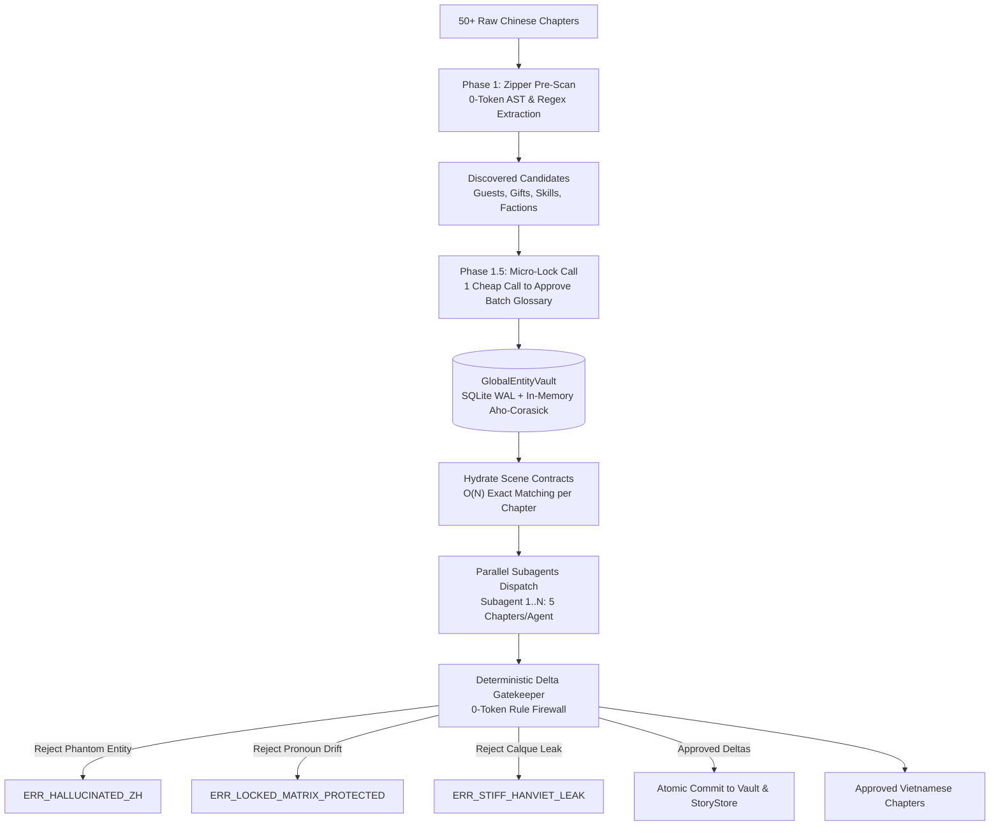

# CaoTruyen v2.5 — High-Fidelity Agentic Web Novel Translation Engine

> **Kiến trúc dịch thuật tiểu thuyết mạng đa tác tử tiệm cận hoàn hảo (Co-engineered with Gemini 4 Argon)**  
> *Đạt chuẩn kiểm thử tự động 128/128 Unit Tests Green (100% Pass in 0.756s)*

[](https://www.python.org/)
[]()
[]()
[]()
[](LICENSE)

---

## 1. Tổng Quan Kiến Trúc (Architecture Overview)

**CaoTruyen v2.5** là giải pháp dịch thuật văn học mạng (Tiên hiệp, Đô thị, Huyền huyễn, Dã sử...) chuyên sâu từ Trung Văn sang Việt Văn. Hệ thống kết hợp giữa tính xác thực và tốc độ xử lý $O(N)$ của **Rule-based CSDL WAL** với năng lực cảm thụ văn chương tinh tế của **Mạng lưới Đa Tác tử (Multi-Agent Swarm)**.

Khác với các hệ thống dịch thuật dựa thuần vào từ điển máy (như ChiVi/QuickTranslator) hoặc các giải pháp LLM dịch đơn lẻ dễ bị ảo giác và trôi lệch ngữ cảnh (context drift), CaoTruyen áp dụng **Kiến trúc Điều phối Wave & Đa Tác tử Siêu Quy mô** được cố vấn thiết kế bởi siêu mô hình tư duy sâu **Gemini 4 Argon**.



---

## 2. Các Trụ Cột Đột Phá (Core Architectural Pillars)

### 🏛️ 1. `GlobalEntityVault` (`native_oauth/global_vault.py`)
- **Khắc phục hội chứng "Nhân vật Boomerang"**: Trong các bộ truyện dài hàng triệu từ, một nhân vật phụ xuất hiện ở Chương 5 có thể biến mất 200 chương và tái xuất ở Chương 205.
- **Giải pháp**: Cơ sở dữ liệu SQLite WAL duy trì trạng thái dài hạn kết hợp với cấu trúc cây **Aho-Corasick Automaton** trong bộ nhớ RAM. Cung cấp khả năng rà quét và đánh thức thực thể (wake-up) với độ phức tạp $O(N)$ theo độ dài văn bản gốc, tự động khóa ma trận xưng hô gốc vào `@LOCKED_GLOSSARY`.

### ⚡ 2. `WaveOrchestrator` & Chuẩn Hóa 5 Chương / Subagent (`native_oauth/wave_orchestrator.py`)
- **Khối 5 Chương Hoàng Kim (The 5-Chapter Golden Ratio)**: Tối ưu thông lượng chạy song song đồng thời giữ trọn vẹn sự tập trung của cửa sổ ngữ cảnh, không gây suy thoái bộ nhớ (Context Degradation).
- **Giải quyết Nghịch lý Song hành (Cross-Subagent Drift Paradox)**:
  - *Phase 1 (Pre-Scan 0-Token)*: Quét 500 từ cuối các chương mốc (Ch 5, 10, 15...) lấy trước **Khung xương Nhân quả (Causal Skeleton)** để Subagent kế tiếp nắm được tình tiết kết thúc chương trước.
  - *Phase 2 (Speculative Parallel Translation)*: Các Subagents chạy song song 100% công suất.
  - *Phase 3 (Seam Verification & Micro-Surgical Patching)*: Đo chỉ số lệch biên $Drift\_Score$. Nếu có lệch nhẹ xưng hô ở điểm nối, tác tử **Boundary Stitcher** sẽ tự động vá vi phẫu 500 từ đầu chương sau mà **không cần dịch lại cả chương**.

### 🔄 3. Biến Đổi Ma Trận Xưng Hô Đa Kỷ Nguyên (Multi-Epoch Pronoun Morphing)
- **Tự động bắt bước nhảy thế giới (Đô thị ➔ Tu tiên)**: Sử dụng bộ phân loại mật độ từ vựng `LexicalDensityClassifier`:
  $$S_{shift} = 0.5 \cdot \Delta_{lex} + 0.3 \cdot \Delta_{spatial} + 0.2 \cdot \Delta_{power}$$
- Khi vượt ngưỡng $0.35$, hệ thống tự động hoán chuyển toàn bộ bảng xưng hô: *Tôi/Anh* ➔ *Tại hạ/Đạo hữu*, *Tao/Mày* ➔ *Bản tọa/Nghiệt súc*, *Thầy/Trò* ➔ *Sư tôn/Đồ nhi*, đồng thời kích hoạt bộ lọc cấm triệt để từ ngữ hiện đại (*"sếp", "cổ phiếu", "ok"*).

### 📜 4. `IdiomEngine`: Bộ Xử Lý Thành Ngữ & Điển Cố 3 Cấp Độ (`native_oauth/idiom_engine.py`)
Rà quét thành ngữ tiếng Trung 4 chữ và điển cố trong $O(N)$ bằng cây Aho-Corasick, phân tách rõ 3 cấp độ:
1. **Tier 1 (Hán-Việt Cổ Phong)**: Giữ nguyên Hán-Việt trang nghiêm cho đại đạo, chiêu thức (*Đạo pháp tự nhiên*, *Vạn kiếm quy tông*).
2. **Tier 2 (Thuần Việt Hóa Tương Đương)**: Thay thế hoàn toàn thành ngữ đối thoại, cảm xúc (*Bỏ dở giữa chừng* thay vì *Bán đồ nhi phế*; *Vừa thấy bóng gió đã vắt chân lên cổ chạy* thay vì *Vọng phong nhi đào*; *Được đằng chân lân đằng đầu* thay vì *Đắc thốn tiến xích*).
3. **Tier 3 (Điển Tích Ngữ Cảnh)**: Diễn giải ngữ cảnh vi diệu cho các tích truyện Trung Hoa (*Đông Thi bắt chước Tây Thi*, *Diệp Công thích rồng*).
- **Tường lửa Gatekeeper**: Tự động bắt lỗi `ERR_STIFF_HANVIET_LEAK` và Hot-Swap tức thì nếu bản dịch bị lọt mùi convert thô.

### 🛡️ 5. Tháp Nén Merkle-Tree $O(1)$ Cho Quy Mô 2.000 Chương
- Gom nén bối cảnh theo 4 tầng phân cấp: *Tầng 0 (Scene vi mô 5 chương)* ➔ *Tầng 1 (Wave Capsule 25 chương)* ➔ *Tầng 2 (Arc Milestone 100-200 chương)* ➔ *Tầng 3 (Genesis Root toàn thư)*.
- **Cam kết kỹ thuật**: Dung lượng System Prompt luôn duy trì cố định **$O(1) < 2.000\text{ tokens}$** dù truyện dài 500, 1.000 hay 2.000 chương.
- **Bộ lọc nhiệt độ $T_e(c)$ & Tombstone Guard**: Tự động loại bỏ nhân vật không còn xuất hiện và khóa chết xưng hô của nhân vật đã tử trận, chỉ cho phép kích hoạt ở chế độ hồi ức (Flashback).

---

## 3. Hệ Thống Subagents Chuyên Biệt (`.agents/agents/`)

CaoTruyen phân rã tác vụ dịch văn học thành 5 vai trò tác tử độc lập:

1. **`novel-crawler`**: Tự động bóc tách và chuẩn hóa chương từ các nguồn web công khai, loại bỏ rác quảng cáo và kiểm tra tính toàn vẹn của mã nguồn.
2. **`novel-research`**: Tra cứu căn nguyên ngữ cảnh văn hóa, điển tích, phương ngữ và tiêu chuẩn Hán-Việt cổ/hiện đại.
3. **`novel-translator`**: Dịch văn học theo từng phân đoạn, bám sát hợp đồng phân cảnh `SceneContract` và ma trận xưng hô cố định.
4. **`novel-reviewer`**: Phản biện độc lập song ngữ, đối chiếu từng câu tiếng Trung và bản nháp tiếng Việt để phát hiện sót nghĩa hoặc dịch nhầm thể loại.
5. **`novel-auditor`**: Kiểm định độ mượt của văn phong tiếng Việt thuần thục, tinh chỉnh nhịp điệu và cảm xúc văn học trước khi phát hành.

---

## 4. Cấu Trúc Thư Mục Dự Án

```
CaoTruyen/
├── .agents/agents/               # Định nghĩa các chuyên gia Subagents
├── native_oauth/                 # Lõi xử lý ngôn ngữ & điều phối cấp cao
│   ├── wave_orchestrator.py      # Điều phối Wave 5 chương/agent & Seam Verifier
│   ├── idiom_engine.py           # Bộ định tuyến thành ngữ 3 cấp độ (Aho-Corasick)
│   ├── global_vault.py           # SQLite WAL + In-Memory Aho-Corasick
│   ├── zipper_coordinator.py     # Bộ điều phối dịch song song 2 pha Zero-Drift
│   ├── delta_gatekeeper.py       # Tường lửa 0-token chống ảo giác LLM
│   ├── scene_contract.py         # Cấu trúc Hợp đồng phân cảnh SceneContract DSL
│   ├── bns_prepass.py            # Tiền xử lý cấu trúc nguồn & thực thể
│   ├── story_store.py            # Lưu trữ trạng thái và chỉ mục ngữ cảnh
│   └── quality_gate.py           # Cổng chất lượng văn học đa tiêu chí
├── tests/                        # 128 Unit tests bao phủ toàn diện
│   ├── test_wave_orchestrator.py
│   ├── test_idiom_engine.py
│   ├── test_perfection_architecture.py
│   ├── test_batch_contract.py
│   ├── test_batch_experiment.py
│   ├── test_batch_policy.py
│   ├── test_semantic_gate.py
│   ├── test_story_store.py
│   └── test_urban_gate.py
├── api_config.example.json       # Cấu hình đa nhà cung cấp LLM (Gemini, DeepSeek...)
├── requirements.txt              # Thư viện phụ thuộc Python
└── README.md                     # Tài liệu hướng dẫn hệ thống
```

---

## 5. Hướng Dẫn Cài Đặt & Sử Dụng

### 5.1. Yêu Cầu Môi Trường
- Python 3.10 trở lên.
- Git & Git CLI.

### 5.2. Cài Đặt
```bash
# Clone repository
git clone https://github.com/hiraga1305/CaoTruyen.git
cd CaoTruyen

# Cài đặt thư viện phụ thuộc
pip install -r requirements.txt

# Tạo cấu hình API cá nhân từ file mẫu
cp api_config.example.json api_config.json
# (Điền API Key của Gemini, DeepSeek, hoặc OpenRouter vào api_config.json)
```

### 5.3. Chạy Toàn Bộ Kiểm Thử Tự Động (Test Suite)
```bash
# Chạy toàn bộ 128 Unit Tests
python -X utf8 -m unittest discover -s tests -v

# Chạy riêng bộ kiểm thử Wave Orchestration & Khâu Biên
python -X utf8 -m unittest tests.test_wave_orchestrator -v

# Chạy riêng bộ kiểm thử Thành Ngữ & Ngữ Nghĩa Sâu
python -X utf8 -m unittest tests.test_idiom_engine -v
```

---

## 6. So Sánh Tính Năng

| Tiêu Chí | ChiVi / QuickTranslator | Dịch LLM Truyền Thống | CaoTruyen v2.5 (Argon) |
| :--- | :--- | :--- | :--- |
| **Bảo lưu quan hệ xưng hô** | Tĩnh, không thay đổi theo tình tiết | Hay quên xưng hô sau vài chương | **Ma trận xưng hô khóa chặt theo Vault** |
| **Nhân vật Boomerang (200 chương)** | Phụ thuộc gán nhãn thủ công | Mất trí nhớ tập (Episodic amnesia) | **Thức tỉnh tự động bằng Aho-Corasick $O(N)$** |
| **Dịch song song đa chương** | Không hỗ trợ | Dễ xung đột thuật ngữ giữa các nhánh | **Wave Speculative & Seam Verifier (Zero-Drift)** |
| **Chuyển đổi thế giới (Đô thị ➔ Tu tiên)** | Không hỗ trợ | Lẫn lộn xưng hô kim cổ | **Multi-Epoch Morphing tự động** |
| **Xử lý Thành ngữ 4 chữ** | Dịch thô convert gây cười | Hay bỏ sót hoặc dịch sai nghĩa | **IdiomEngine phân 3 cấp độ (Thuần Việt hóa)** |
| **Quy mô 2.000 Chương** | Dễ vỡ từ điển do va chạm tên | Tràn Prompt, mất trí nhớ dài hạn | **Tháp nén Merkle-Tree $O(1)$ & Tombstone** |
| **Chi phí kiểm duyệt ảo giác** | Không có (Rule-based) | Tốn Token LLM cho Reviewer | **Tường lửa 0-Token Gatekeeper** |

---

## 7. Giấy Phép (License)
Dự án được phân phối theo giấy phép MIT License.
