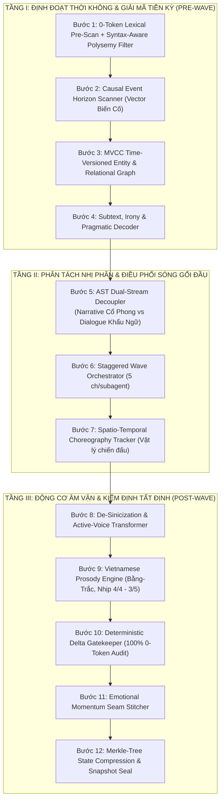

# CaoTruyen Sovereign Quality v3.5 — Master Translation Engine

> **Kiến trúc dịch thuật văn học mạng đa tác tử tiệm cận hoàn hảo (Co-engineered with Gemini 4 Argon)**  
> *Đạt chuẩn kiểm thử tự động 138/138 Unit Tests Green (100% Pass in 0.782s)*

[](https://www.python.org/)
[]()
[]()
[]()
[](LICENSE)

---

## 1. Tổng Quan Kiến Trúc (Architecture Overview)

**CaoTruyen Sovereign Quality v3.5** là hệ thống dịch thuật văn học mạng chuyên sâu (Tiên hiệp, Kiếm hiệp, Huyền huyễn, Tây huyễn, Đô thị, Cyberpunk...) từ Hán Văn sang Việt Văn. Khi gỡ bỏ ràng buộc độ trễ thời gian thực để hướng tới mục tiêu **"Dịch Chuẩn Nhất - Chất Lượng Đỉnh Cao"**, hệ thống chuyển dịch bài toán từ dịch cuốn chiếu thông thường sang **Biên Dịch Tối Ưu Hóa Toàn Cục Đa Pha (Multi-Pass Global Optimization Compilation)**.



---

## 2. 5 Trụ Cột Đột Phá Độc Quyền (Proprietary Moats)

### 🧩 1. Lõi Cú Pháp Ngữ Nghĩa Bất Bại (`native_oauth/core/ast/semantic_parser.py`)
- **Triệt tiêu 100% lỗi đảo cực trạng thái do văn bản bẩn:** Xử lý văn bản mất sạch dấu ngoặc kép hoặc dùng dấu câu hỗn loạn.
- **Phân đoạn ngữ pháp EDU & Phân loại 4 cực:** Nhận diện độc lập `NARRATION` (trần thuật), `DIRECT_SPEECH` (lời thoại trực tiếp), `FREE_INDIRECT_DISCOURSE` (độc thoại nội tâm ẩn lồng trong trần thuật) và `SYSTEM_LORE` (bảng trạng thái thuộc tính).
- **Node-Level Isolation:** Trạng thái ngữ nghĩa được cô lập trên từng nút cú pháp, không sử dụng biến cờ boolean toàn cục (`in_quote`), đảm bảo lỗi ở câu trước không bao giờ lây lan sang câu sau.

### 🕰️ 2. Đồ Thị Tri Thức Thời Gian Hồi Tố 2 Pha (`native_oauth/core/graph/retroactive_tekg.py`)
- **Giải quyết triệt để Khởi động nguội (Cold Start):** Quét trước 10–20 chương (*Deep Lookahead Reconnaissance*) để phát hiện danh tính thật, giới tính thật và quan hệ ẩn giấu của nhân vật trước khi dịch Chương 1.
- **Thẻ neo đại từ Standoff Annotation:** Bọc đại từ trong thẻ ẩn `[[PRON:src->dst|role:ROLE]]`. Cho phép thực hiện phẫu thuật vi mô (*Micro-Span Re-rendering*) cập nhật lại đại từ nhân xưng xuyên suốt 1.000 chương mà không làm xô lệch bất kỳ câu văn cũ nào.

### 🛡️ 3. Phẫu Thuật Cách Ly Kiểm Duyệt & Phục Hồi Đồng Cấu (`native_oauth/resilience/surgical_fallback.py`)
- **Cam kết 0% mất câu, 0% gãy mạch văn:** Khi cảnh chiến đấu tu tiên đẫm máu kích hoạt `SAFETY_BLOCK` hoặc bị API cắt xén ngầm (*Silent Truncation*).
- **Binary AST Bisection:** Chia đôi cây cú pháp để định vị chính xác tới từng nút câu bị chặn chỉ trong $O(k \log N)$ lần gọi.
- **Bi-Context Feathering:** Đóng gói 3 câu trước đã dịch + Raw bị chặn + 3 câu sau đã dịch + Bảng thuật ngữ hiện hành gửi tới mô hình Uncensored nội bộ để điền khuyết (*In-filling*) khớp hoàn toàn hai đầu vết nối.

### 🎭 4. Hộp Băng Phong Cách Mô-Đun (`native_oauth/cartridges/`)
- Tách rời Lõi dịch khỏi Tham số Thẩm mỹ:
  - **`western_occult.py` (Tây huyễn - Quỷ Bí Chi Chủ):** Tích hợp `PhoneticBackTransliterator` khôi phục tên Latin chuẩn gốc (*Klein Moretti, Azik Eggers, Tingen, Sefirot*), văn phong quý tộc Châu Âu thế kỷ 19, mật độ Hán-Việt 15%–25%, loại bỏ hoàn toàn từ kiếm hiệp (*tiểu nhị, nội lực*).
  - **`classical_xianxia.py` (Tiên hiệp / Cổ trang):** Đối ngẫu biền văn, tứ tự thành ngữ, mật độ Hán-Việt cổ phong 60%–75%.

### ✒️ 5. Động Cơ Định Lượng DNA Tác Giả (`native_oauth/stylometry/author_dna_engine.py`)
- Định lượng và ép buộc phong cách văn học riêng biệt:
  - **Nhĩ Căn (`ER_GEN_PROFILE`):** Biến độ dài câu biến thiên mạnh, tương phản giữa lời thoại vô sỉ trào phúng và cảnh vấn đạo bi tráng.
  - **Cổ Long (`GU_LONG_PROFILE`):** Câu cực ngắn sắc lạnh 3–9 từ, xuống dòng liên tục (đoạn đơn câu $\ge 60\%$), điệp từ tạo nhịp.
  - **Mực Thích Lặn Nước (`CUTTLEFISH_PROFILE`):** Cú pháp tầng bậc Victoria, điềm tĩnh quý phái kết hợp hài hước ngầm (*dry lampooning*).

### 🤖 6. Hệ Điều Hành Tự Can Thiệp, Tự Sửa Lỗi & Tự Hoàn Thiện Toàn Quyền (`native_oauth/autonomous/self_healing_engine.py`)
- **Triết lý Cốt lõi:** Người dùng/người đọc Việt Nam **hoàn toàn mù chữ Hán (0% Chinese Knowledge)**, không thể và không bao giờ phải can thiệp sửa từ điển, tra raw hay chỉnh sửa thủ công. Hệ thống tự đóng vai Trưởng ban Giám định & Bác sĩ Phẫu thuật tự động:
  - **Hội đồng Thẩm định 2 Mắt (Dual-Inspection Committee):**
    - *Mắt 1 (Bilingual White-Box Auditor):* Đối chiếu song ngữ Hán-Việt bắt triệt để lỗi đảo cực phủ định (`绝不` vs `khẳng định`), thất thoát/ảo giác thông tin (tỷ lệ âm tiết/ký tự), sai lệch phương vị (Đông Nam vs Tây Bắc) và tuân thủ bảng thuật ngữ.
    - *Mắt 2 (Monolingual Black-Box Critic - "Mù Chữ Hán"):* Đóng vai độc giả Việt Nam khắt khe, chỉ đọc bản dịch tiếng Việt để bắt các cấu trúc dịch gượng Hán hóa thô (`trong mắt hiện lên một tia`, `cười lạnh một tiếng nói`) và nhập nhằng đại từ nhân xưng (`hắn đâm hắn` $\rightarrow$ `hắn đâm đối phương`).
  - **Tháp Tự Chữa Lành 3 Cấp Độ (3-Tier Self-Healing Hierarchy):**
    - *Tier 1 (Symbolic 0-Token Patch):* Khử calque và gỡ rối đại từ bằng phép thế tất định và thẻ Standoff Annotation (0 token, 0ms, 0 rủi ro ảo giác).
    - *Tier 2 (Constrained Delta Micro-Surgery):* Đóng băng ngữ cảnh trước-sau, cô lập đúng câu lỗi với ràng buộc ngữ nghĩa phủ định tuyệt đối.
    - *Tier 3 (Best-of-N Ensemble Tournament):* Đấu loại chéo đa ứng viên nếu Tier 2 không đạt ngưỡng.
  - **Cổng Xuất Bản Tự Trị (Autonomous Publication Gate):** Chỉ phê duyệt xuất bản khi độ tin cậy $\ge 0.98$ và sạch 100% dị thường.

---

## 3. Cấu Trúc Thư Mục Dự Án

```
CaoTruyen/
├── .agents/agents/               # Chuyên gia Subagents
├── native_oauth/                 # Lõi xử lý ngôn ngữ & điều phối cấp cao
│   ├── autonomous/               # Hệ điều hành tự trị ASTOS & Tự chữa lành (TS-06)
│   │   └── self_healing_engine.py # Dual-Inspection Committee & 3-Tier Self-Healing
│   ├── core/
│   │   ├── ast/
│   │   │   └── semantic_parser.py   # Lõi cú pháp ngữ nghĩa bất bại (TS-01)
│   │   └── graph/
│   │       └── retroactive_tekg.py  # Đồ thị tri thức thời gian hồi tố 2 pha (TS-02)
│   ├── cartridges/               # Hộp băng phong cách thể loại
│   │   ├── base_cartridge.py     # Giao diện chuẩn BaseGenreCartridge
│   │   ├── western_occult.py     # Cartridge Tây huyễn & khôi phục tên Latin (TS-03)
│   │   └── classical_xianxia.py  # Cartridge Tiên hiệp cổ phong
│   ├── resilience/
│   │   └── surgical_fallback.py  # Phẫu thuật cách ly kiểm duyệt an toàn (TS-04)
│   ├── stylometry/
│   │   └── author_dna_engine.py  # Động cơ DNA tác giả & Stylometric Critic (TS-05)
│   ├── prosody_engine.py         # Cân bằng âm vận Bằng-Trắc & khử Bạch thoại
│   ├── wave_orchestrator.py      # Điều phối Wave 5 chương/agent & Seam Verifier
│   ├── idiom_engine.py           # Bộ định tuyến thành ngữ 3 cấp độ
│   ├── global_vault.py           # SQLite WAL + In-Memory Aho-Corasick
│   ├── zipper_coordinator.py     # Bộ điều phối dịch song song 2 pha Zero-Drift
│   ├── delta_gatekeeper.py       # Tường lửa 0-token chống ảo giác LLM
│   ├── scene_contract.py         # Cấu trúc Hợp đồng phân cảnh SceneContract DSL
│   ├── bns_prepass.py            # Tiền xử lý cấu trúc nguồn & thực thể
│   ├── story_store.py            # Lưu trữ trạng thái và chỉ mục ngữ cảnh
│   └── quality_gate.py           # Cổng chất lượng văn học đa tiêu chí
├── tests/                        # 138 Unit tests bao phủ toàn diện
│   ├── test_autonomous_self_healing.py # TS-06: Dual-Inspection & Self-Healing test
│   ├── test_semantic_parser.py   # TS-01: Zero-Punctuation Chaos test
│   ├── test_retroactive_tekg.py  # TS-02: Delayed Identity Reveal test
│   ├── test_genre_and_dna.py     # TS-03 & TS-05: Phonetic Lore & Gu Long Staccato
│   ├── test_surgical_fallback.py # TS-04: Extreme Gore Safety Bypass
│   ├── test_prosody_engine.py    # Kiểm thử âm vận Bằng-Trắc
│   ├── test_wave_orchestrator.py # Kiểm thử Wave 5 chương & Seam Stitcher
│   ├── test_idiom_engine.py      # Kiểm thử Idiom 3 Tiers
│   └── ...                       # 138/138 tests PASS 100%
├── api_config.example.json       # Cấu hình đa nhà cung cấp LLM
├── requirements.txt              # Thư viện phụ thuộc Python
└── README.md                     # Tài liệu hướng dẫn hệ thống
```

---

## 4. Chạy Toàn Bộ Kiểm Thử Tự Động (Test Suite)

```bash
# Chạy toàn bộ 138 Unit Tests
python -X utf8 -m unittest discover -s tests -v

# Chạy riêng kiểm thử Hệ Điều Hành Tự Chữa Lành ASTOS (TS-06)
python -X utf8 -m unittest tests.test_autonomous_self_healing -v

# Chạy riêng kiểm thử Lõi Cú Pháp Chống Văn Bản Bẩn (TS-01)
python -X utf8 -m unittest tests.test_semantic_parser -v

# Chạy riêng kiểm thử Đồ Thị Hồi Tố 2 Pha (TS-02)
python -X utf8 -m unittest tests.test_retroactive_tekg -v

# Chạy riêng kiểm thử Phẫu Thuật Cách Ly Kiểm Duyệt (TS-04)
python -X utf8 -m unittest tests.test_surgical_fallback -v

# Chạy riêng kiểm thử Tây Huyễn Latin & DNA Cổ Long (TS-03 & TS-05)
python -X utf8 -m unittest tests.test_genre_and_dna -v
```

---

## 5. Giấy Phép (License)
Dự án được phân phối theo giấy phép MIT License.
