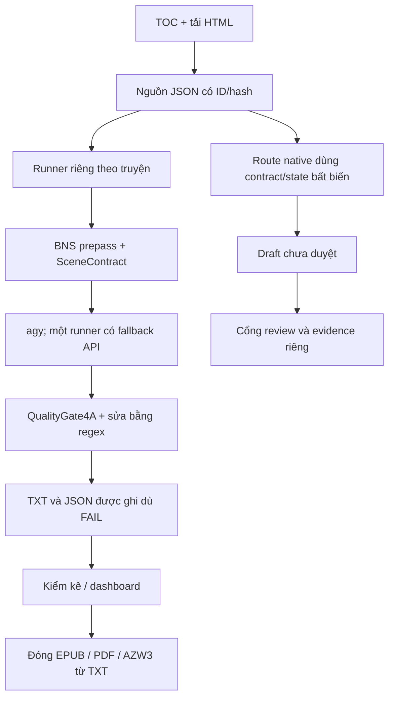

# Đánh giá luồng cào – dịch CaoTruyen, 21/10/2026

> Báo cáo này giữ nguyên phát hiện trước khi sửa, tại commit đã nêu. Xem `audit/pipeline_root_cause_and_fix_20261021.md` cho nguyên nhân timeout đã xác nhận và các thay đổi sau đó. Script tái hiện hiện ghi `pipeline_review_current.evidence.json` để giữ nguyên bằng chứng ban đầu.

## Kết luận

Luồng đã tạo được dữ liệu và sách thực tế, nhưng **chưa đủ tin cậy để tự xác nhận hoàn tất hoặc xuất bản toàn truyện**. Điểm yếu chính là đường chạy theo từng truyện bỏ qua trạng thái FAIL, trong khi kiểm kê và dashboard tiếp tục báo đủ. Đây là lỗi đã xuất hiện trong dữ liệu và EPUB hiện có, không chỉ là khả năng lý thuyết.

Mã nguồn local tại lúc bắt đầu sạch, nhánh `main`, HEAD `a81dd75e1693d772ed76e0ecb51704de817239d1`. Đã đối chiếu cùng SHA qua GitHub connector và `git ls-remote`; remote là `https://github.com/hiraga1305/CaoTruyen.git`. Kết luận đồng bộ áp dụng cho phần được Git theo dõi. Credential, môi trường Python, model, SQLite và HTML gốc nằm trong các đường dẫn được ignore nên không thể hiểu là toàn bộ dữ liệu máy đã có trên GitHub.

Không sửa mã sản phẩm, bản dịch hoặc sách trong lượt đánh giá. Chỉ thêm báo cáo, bằng chứng và script tái hiện trong `audit/`. Không cào lại website, gọi model, đọc credential hoặc đẩy GitHub.

## Phạm vi và kết quả đo

Đọc các entrypoint gốc, hai route native, các runner của ba truyện, cổng kiểm tra, crawler, monitor, bộ kiểm kê và bộ đóng sách. Đối chiếu cấu trúc toàn bộ 325 nguồn/JSON/TXT của truyện 49736; kiểm EPUB mẫu; chạy 142 test hiện có và các phép tái hiện ngoại tuyến.

| Dữ liệu local | Nguồn JSON | TXT | JSON song ngữ |
|---|---:|---:|---:|
| Book 14713 | 51 | 51 | 0 |
| Book 16014 | 5 | 1 | 0 |
| Book 49736 | 325 | 325 | 325 |

Book 49736 có 325 HTML gốc local; tất cả 325 `package_hash` nguồn tự kiểm lại đều khớp. Có 31.034 đoạn nguồn, 30.744 bản ghi song ngữ, khoảng 856.201 đơn vị tách bằng khoảng trắng trong TXT. Những số này không đo độ đúng nghĩa.

**142/142 test qua**, không lỗi hoặc skip, trong môi trường `.venv`. State/dashboard của SessionMonitor được chuyển sang thư mục tạm để không ghi vào phiên Antigravity thật. Các test phần lớn kiểm module/fixture; chúng không chứng minh đường xuất bản 325 chương đã được kiểm end-to-end.

## Luồng thực tế



Có hai hệ thống bảo đảm chất lượng chưa thống nhất:

- `semantic_gate.py`, `pipeline_native.py`, `batch_contract.py`, `batch_run.py` có khóa nguồn, kiểm runtime/cache và phân biệt draft với approved. Đây là nền tảng tốt để hợp nhất.
- Các runner `book_*/batch_pipeline_runner.py`, `book_49736/wujian_pipeline_runner.py` và các wave/pool dùng cổng nhẹ rồi ghi trực tiếp `output_dich`. Chúng không đi qua cùng cổng xuất bản có evidence ở trên. Trong book 49736 không tìm thấy `*.evidence.json` hoặc `*.publication.json` của cổng đó.

## Phát hiện ưu tiên

### F01 — P1: Bản dịch thiếu đoạn đã đi vào EPUB

Sáu chương có `source_hash` khớp nguồn hiện tại nhưng thiếu bản ghi tương ứng với đoạn thân truyện:

| Chương theo chỉ số nội bộ | Đoạn nguồn | Bản ghi thực tế | Thiếu | JSON vẫn khai đã dịch |
|---|---:|---:|---:|---:|
| 239 | 102 | 87 | 15 | 102 |
| 248 | 109 | 96 | 13 | 109 |
| 299 | 170 | 98 | 72 | 170 |
| 306 | 197 | 148 | 49 | 197 |
| 310 | 163 | 120 | 43 | 163 |
| 318 | 247 | 172 | 75 | 247 |
| **Tổng** | | | **267** | |

Chương 239 dừng ở `Bất c`; chương 318 dừng ở `Nghĩ vậy, Tát Nhược liền lấy áo khoác của mình bọc kỹ`. Đã đọc trực tiếp các file `EPUB/chap_0239.xhtml` và `EPUB/chap_0318.xhtml` trong sách: giữ nguyên hai câu cụt này. Chương 299 thiếu đoạn giữa, từ `c0299p0014` đến `c0299p0085`; đọc riêng phần cuối chương sẽ không phát hiện.

`wujian_pipeline_runner.py:250–265` nhận `is_pass` nhưng chỉ in trạng thái, tiếp tục gộp và ghi file tại dòng 285/300, trả `True`; dòng 319 còn ghi monitor `gate_pass=True`. Các batch runner của 14713, 16014 và 49736 cũng chỉ cảnh báo thiếu rồi lưu.

Tái hiện bằng chính hàm `process_chapter` lấy từ AST, cô lập I/O vào thư mục tạm: nguồn 4 đoạn, hai scene đều trả FAIL và chỉ có một đoạn mỗi scene; hàm vẫn trả thành công, ghi TXT/JSON với 2 đoạn và gửi monitor PASS. Không gọi LLM trong phép thử này.

**Cần sửa:** FAIL/thiếu/rỗng phải dừng ghi bản hoàn tất; giữ draft và lỗi riêng. Bắt buộc phủ đúng tập ID nguồn trước khi publish. `build_ebooks.py:121` hiện chỉ đọc TXT, bỏ qua chương thiếu và không yêu cầu bằng chứng duyệt; cần chặn đóng sách nếu tập chương hoặc hash chưa đủ. Chưa kiểm nội dung PDF/AZW3, không suy rộng kết quả đọc EPUB sang hai định dạng đó.

### F02 — P1: Bộ audit hiện so hai số tự khai, bỏ lọt thiếu đoạn

`comprehensive_novel_audit.py:107` dựng đường dẫn source nhưng không đọc nó. Dòng 124–125 chỉ so `total_paragraphs` và `translated_paragraphs` trong cùng sidecar, không kiểm độ dài `bilingual_alignment`, tập ID hay TXT. Tầng “entity consistency” chủ yếu đếm tên trong tiếng Việt, không đối chiếu thực thể với từng đoạn nguồn.

Báo cáo lưu sẵn `audit/full_novel_325_audit_report.json` vì thế ghi 325 chương verified, 31.011/31.011 đoạn và không lệch đoạn, dù dữ liệu thực tế ở F01 thiếu. Chữ “verified” hiện vượt phạm vi phép kiểm.

**Cần sửa:** lấy expected từ nguồn bất biến; actual từ bản ghi thật; kiểm ID, raw, non-empty và hash TXT. Tách kiểm cấu trúc khỏi kết luận ngữ nghĩa/văn học. Chỉ gọi complete sau khi mọi điều kiện bắt buộc đạt.

### F03 — P1: QualityGate4A cho nội dung rỗng, ID trùng và mất dòng qua

`quality_gate.py:203–210` chỉ giữ dòng bắt đầu bằng `§`, rồi ghi vào dictionary theo ID. Tái hiện với contract một đoạn:

| Input thử | Kết quả thực tế |
|---|---|
| `§1 ` | PASS, lưu đoạn rỗng |
| Hai dòng cùng `§1` | PASS, dòng sau đè dòng trước |
| `§1 Dòng đầu.` rồi một dòng tiếp không có tag | PASS, dòng tiếp bị mất |

**Cần sửa:** parse schema rõ ràng, từ chối ID trùng/rỗng/nội dung dư chưa parse; quy định và kiểm cách biểu diễn đoạn nhiều dòng. Kiểm lại bản cuối sau sửa/register postprocess, không dùng trạng thái gate của bản trước khi sửa.

### F04 — P1: Cache bỏ qua bản lỗi; nguồn và evidence đã lệch

`wujian_pipeline_runner.py:220` skip khi TXT/JSON tồn tại; batch runner còn chỉ cần TXT. Vì vậy các chương thiếu ở F01 sẽ được coi là hoàn tất khi chạy lại mặc định.

225 sidecar của chương 1–225 có `source_hash` khác nguồn đang lưu. Trong 29 chương lệch số bản ghi, **23 chương được giải thích chính xác bởi một dòng tiêu đề nguồn được thêm phía trước**, làm ID/raw dịch lệch một vị trí. Không coi 23 trường hợp này là bằng chứng mất nội dung thân truyện. Sáu trường hợp còn lại là F01.

So TXT với JSON sau bỏ các dòng tiêu đề đầu có dạng “Chương N” cho thấy 31 chương còn khác nhau. Có khác biệt do polish thân bài, xóa ký tự trang trí và một trường hợp bố trí tiêu đề ở chương 319; đây không phải 31 lỗi nghĩa đã xác nhận. `surgical_polish_325.py:96–110` ghi lại TXT nhưng chỉ cập nhật tiêu đề của JSON, để bản song ngữ thân bài cũ.

**Cần sửa:** một candidate có ID là nguồn duy nhất để xuất TXT/JSON/sách. Resume dựa trên source hash, candidate hash, cấu hình/prompt/model và receipt hợp lệ. Giữ revision cũ, không gán hash mới cho bản cũ khi chưa xác minh.

### F05 — P2: Genre và continuity chưa theo đúng route đô thị

`bns_prepass.py:570` đặt cứng `genre="XIANXIA"`; runner đô thị không đổi. Prompt thực tế chương 239 scene 2 cũng chứa `genre:XIANXIA`. QualityGate vì vậy có thể dùng nhánh kiểm đại từ tiên hiệp và không dùng nhánh urban.

`wujian_pipeline_runner.py:243` bắt đầu mỗi chương bằng context rỗng; giữa scene chỉ giữ một đoạn cuối, rồi cắt đầu 200 ký tự. Runner batch cũ đọc ba đoạn cuối chương trước nhưng không kiểm đã duyệt, và các block song song có thể đọc khi predecessor chưa xong. `SlidingPoolRunner` khởi tạo `self.guard` nhưng không gọi guard để kiểm đầu ra.

**Cần sửa:** truyền genre tường minh, glossary/alias phồn–giản thể và context nguồn có chứng cứ theo cùng schema; quy định phụ thuộc giữa block. Không coi một đoạn Việt cuối hoặc mô tả bối cảnh cố định là đủ kiểm continuity.

### F06 — P2: Mô hình thực chạy và trạng thái native chưa được giữ đúng

`wujian_pipeline_runner.py:94–130` nhận response native theo chiều dài, không buộc runtime SUCCESS; nuốt exception rồi gọi API chung. Metadata ở dòng 296 vẫn ghi model được yêu cầu ban đầu, không lấy model/provider thực tế từ fallback. Các runtime mẫu bị cụt vẫn mang SUCCESS; riêng chương 299 scene 1 chỉ có 13 dòng tagged trong khi scene sở hữu 85 đoạn.

**Cần sửa:** runtime SUCCESS chỉ là một điều kiện; vẫn phải kiểm toàn bộ coverage. Ghi provenance thực tế từng scene và kiểm finish/stop reason nếu transport cung cấp. Route fallback phải tường minh và giữ provenance; không lấy model yêu cầu làm bằng chứng model thực chạy. Chưa xác minh model hiện có/quota/chi phí bằng cuộc gọi live.

### F07 — P2: Crawler riêng 49736 yếu hơn bộ source_integrity chung

Điểm tốt: lưu HTML nguyên byte, timestamp, raw hash và package hash; dữ liệu local có đủ 325 HTML.

Tuy nhiên `crawl_chapters.py:77` decode UTF-8 với `errors='ignore'`; dòng 91 nhận cache chỉ theo tồn tại file; dòng 99 tự chèn tiêu đề mong đợi khi không khớp. Hàm fetch chưa khóa URL cuối/book/chapter/title thực trả về, nên trang sai hoặc ký tự lỗi có thể thành package trông hợp lệ. Đây là rủi ro từ mã; chưa kết luận hiện có chương tải sai truyện.

**Cần sửa:** decode strict, kiểm redirect/định danh/title độc lập, TOC manifest có version và kiểm cache. Dùng adapter nguồn có contract thống nhất, giữ nguyên raw; không chèn title để thay cho xác minh đúng trang.

### F08 — P2: Dashboard có thể báo 100% trước khi hoàn tất

`session_monitor.py:158/182` lấy số chương lớn nhất đã active chia tổng chương. Tái hiện chỉ gọi worker active chương 325, chưa có completion nào: badge báo 100%. `record_chapter_done` luôn gán COMPLETED kể cả `gate_pass=False`; gọi lại cùng chương hai lần cộng từ hai lần. Ghi state không atomic/không lock và không phục hồi tập completed có ID để chống đếm lặp.

Nhiều runner chưa gọi `record_worker_active`/in badge theo vòng đời; runner mới chỉ thử ghi monitor ở cuối và nuốt mọi lỗi. Việc chọn conversation mới sửa gần nhất cũng không chứng minh đó là phiên đang chạy. Cơ chế hiện chưa đáp ứng đầy đủ AGENTS.md về hiển thị đúng phiên và trạng thái chương/wave.

**Cần sửa:** tiến độ tính theo tập chapter revision đã PASS, tách ACTIVE/FAILED/APPROVED. Một writer/transaction cho state, artifact_dir/conversation_id tường minh, sự kiện idempotent. Hiển thị đủ range/genre/từ/đoạn/worker và báo lỗi đồng bộ thấy được.

### F09 — P2: Các cam kết kiến trúc vượt phần đã tích hợp và kiểm chứng

Quét import mã ngoài tests/audit cho thấy `AutonomousSelfHealingEngine`, `SurgicalSafetyResilience` và author DNA chưa được runner sản phẩm gọi; SemanticAST/TEKG chủ yếu nối giữa các module thử nghiệm đó. Có mã và unit test không đồng nghĩa hệ dịch 325 chương đang sử dụng chúng.

Self-healing hiện dùng heuristic/regex. Phép thử nguồn “Trương Tam giết Lý Tứ tối qua”, bản dịch đảo thành “Lý Tứ giết Trương Tam tối qua”, vẫn cho `publication_approved=True`, confidence 1.0. Điểm 0.98/1.0 là công thức trừ lỗi heuristic, không phải xác suất đúng đã hiệu chuẩn. Không nên dùng làm chứng nhận nghĩa.

README khẳng định 0% mất câu, 100% loại lỗi, bao phủ toàn diện và sẵn sàng quy mô lớn chưa được bằng chứng hiện tại hỗ trợ. `requirements.txt` chỉ có BeautifulSoup, còn bộ đóng sách import PyMuPDF/ebooklib/Pillow/reportlab và cần Calibre/font Windows. Không có workflow `.github/` được theo dõi ở commit này.

**Cần sửa:** ghi rõ implemented/integrated/experiment/validated; mô tả giới hạn phép kiểm. Thêm dependency theo nhóm và kiểm runner thực trong CI. Không cần mở rộng hạ tầng để giải các lỗi logic này.

## Thứ tự xử lý đề nghị

1. Đánh dấu sáu chương F01 và EPUB hiện có là cần phục hồi; ngừng dùng nhãn “toàn tập hoàn chỉnh/verified” làm bảo đảm. Giữ bản cũ để đối chiếu. Khôi phục từ source/ID, kiểm lại toàn chương và biên trước–sau rồi mới đóng sách lại.
2. Sửa F01–F04 trước khi chạy hàng loạt: FAIL phải chặn; audit lấy số thật; parser chặn rỗng/trùng/mất dòng; resume theo receipt và hash. Thêm test tích hợp runner → FAIL → không có artifact approved, và publisher từ chối chương thiếu.
3. Hợp nhất một runner cấu hình theo book/genre/source adapter. Tận dụng contract/hash/state và semantic gate hiện có; hai schema `bns-source-v1` và `semantic-gate-1` cần adapter được kiểm, không nối tắt bằng đổi nhãn version.
4. Sửa genre, continuity, provenance và monitor; tách approved/draft/quarantine, chỉ đóng sách từ manifest approved. Xuất TXT/JSON/EPUB từ cùng candidate đã duyệt.
5. Sau khi đường chạy an toàn, benchmark trên scene/chương chưa dùng khi viết prompt/test, có phủ định, chủ thể, đơn vị, đổi vai và tiết lộ danh tính. Đo lỗi còn lọt, retry/quarantine, token và thời gian thực; chưa cần nâng cấp số worker hoặc thêm module phức tạp.

Đánh giá: phần lưu nguồn và các contract đã có giá trị để xây tiếp; điều phối chạy được; kiểm chất lượng và xuất bản hiện cần sửa trước khi tin vào “hoàn tất”. Chưa chấm tỷ lệ đúng nghĩa/văn học của toàn truyện vì chưa đọc song ngữ toàn bộ 31.034 đoạn.

## Bằng chứng và tái hiện

- `audit/pipeline_review_20261021.evidence.json`: danh sách chương/ID, hash mismatch, khác TXT–JSON, EPUB mẫu, test và kết quả tái hiện.
- `audit/reproduce_pipeline_review_20261021.py`: chỉ đọc dữ liệu sản phẩm; chạy synthetic và tests trong temp; ghi lại evidence. Không dùng mạng/model/credential.

```powershell
.\.venv\Scripts\python.exe -X utf8 audit/reproduce_pipeline_review_20261021.py
```

Phạm vi kiểm: mã và dữ liệu local ở SHA đã nêu, nguồn GitHub cùng SHA, cấu trúc 325 chương, EPUB mẫu và regression ngoại tuyến. Không chứng nhận tính đầy đủ của website so với bản tác giả, nghĩa toàn truyện, PDF/AZW3, sức chứa hosting hoặc tính khả dụng model hiện tại.
