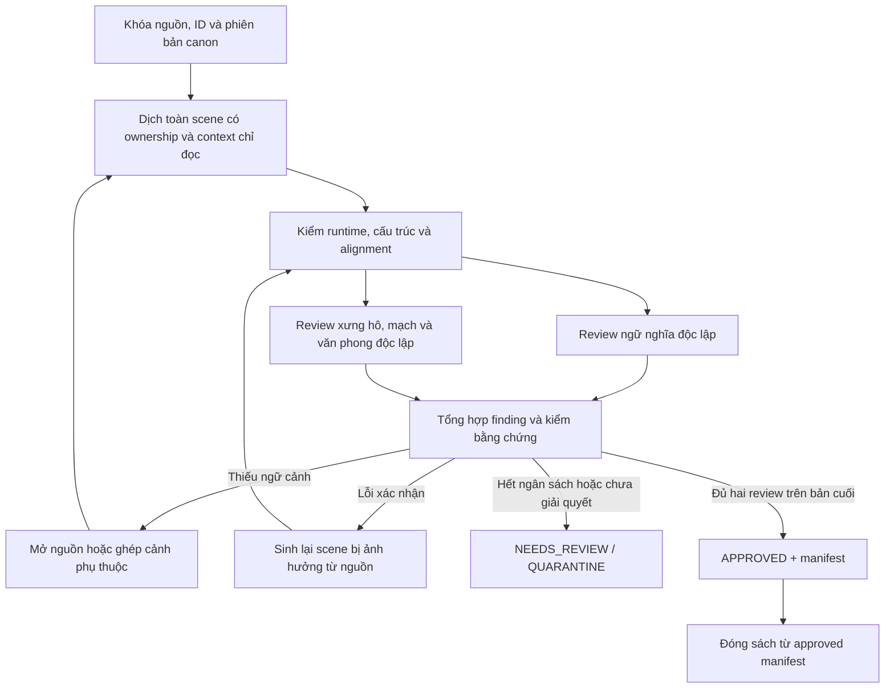

# Rà lại workflow và đề xuất vận hành — 22/10/2026

> **Chốt phạm vi sau phản hồi của người dùng:** Antigravity thực hiện toàn bộ cào → dịch → review → sửa → phê duyệt → xuất bản. Codex kiểm tra chéo và bổ sung hệ thống. Đề xuất review dưới đây phải triển khai trong Antigravity, không biến Codex thành bước duyệt từng chương. [Workflow hiện hành](../native_oauth/ANTIGRAVITY_WORKFLOW.md) thay thế hướng đề xuất dùng Codex làm chuẩn vận hành của báo cáo ban đầu. Các mô tả route Codex/API hiện có bên dưới là kết quả audit code/pilot, không phải yêu cầu sử dụng chúng trong sản xuất.

**Kết luận: cần review độc lập trước xuất bản. Dự án đã có giao thức và gate cho việc này, nhưng các route dịch hàng loạt chưa tự nối được tới đó.** Ưu tiên là nối đường chạy và thống nhất tiêu chuẩn, đồng thời ngăn các công cụ hậu kỳ cũ phá nội dung. Không cần xây thêm một hệ thống chấm điểm tự tin.

Lượt này rà tài liệu, profile và call path; chỉ tái hiện hành vi trong thư mục tạm. Không gọi model, không chạy dịch/crawl thật, không sửa workflow/code sản phẩm, không thay bản truyện cũ. Các bản sửa local ở những lượt trước được giữ nguyên.

## 1. Bản đồ các luồng hiện có

| Nhóm | Tài liệu và code | Tình trạng quan sát được |
|---|---|---|
| Kiểm dịch API theo chương | `QUALITY_WORKFLOW.md`, `PIPELINE_GUIDE.md`, `quality_pipeline.py`, các entry tương thích ở root | Có translator → hai review độc lập → sửa có giới hạn → review lại → publish. Policy mặc định yêu cầu ba identity model khác nhau. Không phải route OAuth batch mặc định. |
| Pilot OAuth chương đơn + Codex | `native_oauth/WORKFLOW.md`, `pipeline_native.py`, `codex_gate.py` | Translator tạo draft và protocol; dừng ở `DRAFT_READY_FOR_CODEX`. Điều phối viên phải thực sự giao hai session Codex độc lập đọc nguồn–đích; gate chỉ xác minh artifact được giao lại, không tự khởi chạy hai reviewer. Có bằng chứng pilot chương đơn trong repo. |
| Batch source-frozen | `BATCH_WORKFLOW.md`, `batch_route_design.md`, `prepare_batch_route.py`, `story_store.py`, `batch_contract.py`, `batch_run.py` | Có snapshot, nguồn gốc, ownership, overlap, model runtime, merge/resume. Kết thúc là draft chưa duyệt. `commit_block()` khóa khi không có verifier độc lập được cung cấp. Auto semantic/style verifier và thực thi đầy đủ recovery policy còn thiếu. |
| Bốn runner theo sách | `book_14713/batch_pipeline_runner.py`, `book_16014/batch_pipeline_runner.py`, hai runner 49736 → `chapter_runner.py` | Đã dùng chung kiểm cấu trúc/runtime, context nguồn quanh chunk, tên/xưng hô bảo thủ, draft receipt và SessionMonitor. Chỉ tạo `DRAFT_STRUCTURAL_PASS_UNREVIEWED`; chưa xuất job review/protocol theo schema chuẩn và chưa tự promote bản được duyệt. |
| Điều phối wave/pool 49736 | `sliding_pool_runner.py`, `wave_runner.py`, `book_49736/wave_orchestrator.py` | Gọi runner dịch và kiểm kết quả công việc. Chưa có bước review nội dung giữa các wave. “Calibration Gate” ở orchestrator này chỉ là nghỉ 5 giây. |
| Thư viện AST/TEKG/zipper/seam/self-healing | `native_oauth/wave_orchestrator.py`, `zipper_coordinator.py`, `autonomous/self_healing_engine.py` và các module liên quan | Có logic/thử nghiệm riêng; không phải toàn bộ đều nối vào đường chạy của bốn runner. Điểm heuristic không chứng nhận nghĩa. `publication_approved` của self-healing hiện đã bị khóa false bởi bản sửa trước. |
| Hậu kỳ/đóng sách | `urban_auditor.py`, `surgical_polish_325.py`, `build_ebooks.py` | Polisher 49736 hiện tạo đề xuất chưa duyệt; đóng sách đòi evidence khớp. UrbanAuditor cũ vẫn xóa chữ Hán và ghi đè TXT — đây là đường nguy hiểm còn sót, cần xử lý trước vận hành thật. |
| Profile agents và hiển thị | `.agents/agents/*.md`, `.agents/rules/session_visibility.md`, `AGENTS.md` | Đã phân vai crawler/research/translator/reviewer/auditor và cấm tự duyệt, nhưng file khai báo agent không chứng minh agent đã chạy. Yêu cầu hiển thị session chưa được tích hợp thống nhất vào các entry API/native/batch đời trước. |
| Tài liệu triển khai và README thiết kế | `DEPLOYMENT_GUIDE.md`, phần lịch sử README | Đã có ghi chú lịch sử; vẫn chứa nhiều lệnh/khẳng định cũ dễ bị sao chép nhầm. Nên có một tài liệu vận hành hiện hành làm điểm vào duy nhất, dẫn đến các chế độ cụ thể. |

Điểm cần giữ từ `BATCH_WORKFLOW.md`: GPT phục vụ đánh giá route/calibration và audit mẫu; không dùng GPT vá câu từng chương để che lỗi generator. Điều đó **không cho phép bỏ kiểm ngữ nghĩa trước publish**. Batch hiện chủ động dừng ở draft vì chưa có verifier tin cậy.

## 2. Những chỗ cần cải thiện theo ưu tiên

### P0 — Công cụ “audit” cũ có thể xóa phần chưa dịch rồi tự báo đạt

`native_oauth/urban_auditor.py:117` xóa chữ Hán khỏi thân truyện bằng `CJK_PATTERN.sub("", ...)`; dòng 143–150 ghi lại TXT và coi không còn CJK là đạt. `src_path` được tạo nhưng nguồn không được đọc để đối chiếu. Sidecar song ngữ không được cập nhật cùng nội dung.

Tái hiện trong thư mục tạm, không tạo nguồn: **“Anh ấy 走 rồi.” → “Anh ấy  rồi.”**, TXT bị ghi đè và `is_gate_pass=True`. Đây là mất nội dung, không phải sửa bản dịch.

**Đề nghị:** chuyển công cụ này thành chỉ đọc/triage hoặc chỉ tạo đề xuất riêng có alignment; chữ Hán sót tạo finding và yêu cầu dịch lại từ nguồn. Không chạy công cụ hiện tại trên bản truyện thật. Mọi sửa chữ nghĩa phải tạo revision mới và làm mất hiệu lực review cũ.

### P1 — Chưa có cầu nối chạy được từ draft batch tới review/publish

`chapter_runner.py` dừng sau draft, còn `pipeline_native.py` chỉ sinh protocol cho route chương đơn. Source package của sách 49736 được `chapter_integrity.validate_source()` nhận, nhưng đưa nguyên vào `semantic_gate.validate_package()` bị từ chối vì version/schema khác. Có gate đúng không đồng nghĩa các draft hiện tại đi qua được gate đó.

**Đề nghị:** adapter rõ ràng từ source/alignment của sách sang review envelope chuẩn, giữ nguyên mọi ID/đoạn và `origin_source_hash`; gắn book/chapter, canon/profile/prompt/policy version, candidate hash, runtime và source context. Không sửa source package bất biến hoặc gắn cờ PASS bằng tay để vượt khác biệt schema. Tạo review queue và một bước promote sau khi gate xác thực xong; publisher chỉ đọc approved manifest.

### P1 — Guard và “calibration” trong pool chưa đúng lời mô tả

- `SlidingPoolRunner` tạo `self.guard`, nhưng không gọi `self.guard.audit_paragraph()` trong đường xử lý block đã đọc.
- Guard cũ tách từng từ rồi giao với danh sách cấm: **“Chúng ta đi thôi.”** và **“Cô ta nói vậy.”** bị cờ `ERR_PRONOUN_MUTATION` vì từ “ta”; **“Tại hạ xin cáo từ.”** lại không bị cờ do “tại hạ” gồm hai từ. Đây là bằng chứng detector từ vựng vừa báo sai vừa bỏ lọt chính mẫu nó định tìm; không phải kết luận mọi từ cổ đều sai trong truyện đô thị.
- Chỉ nghỉ quota 5 giây không xác minh liên tục tên/xưng hô/sự kiện giữa wave.

**Đề nghị:** dùng một registry và một cơ chế triage chung; cờ từ vựng là yêu cầu đối chiếu nguồn, không ép sửa đại từ. Cuối wave phải kiểm nội dung các seam/chuyển quan hệ và cập nhật canon có căn cứ; đổi tên bước nghỉ quota cho đúng chức năng.

### P1 — Cache/resume chưa dùng thống nhất kiểm tra runtime hoàn chỉnh

Trong một fixture có contract/candidate/receipt đồng bộ, `batch_run.verified_cached_result()` nhận runtime `SUCCESS` nhưng `partial_output=True`; cùng runtime bị `require_complete_runtime()` từ chối. Đây là thử guard tổng hợp, **không khẳng định đã tìm thấy artifact thật của batch mang đúng tổ hợp này**. `run_agy.py` đã được sửa để phân loại timeout cho lời gọi mới, nhưng cache cũ không tự được phân loại lại chỉ vì wrapper đã sửa.

**Đề nghị:** dùng chung bộ xác minh runtime cho mọi entry và resume; kiểm exit/model/partial/terminal state/owned IDs/nội dung không rỗng, đồng thời khóa phiên bản recipe/checker. Cache từ luật cũ cần audit hoặc chạy mới; không mặc định kế thừa SUCCESS cũ.

### P1 — Review chung chưa diễn đạt đủ các trường hợp xưng hô/bất định

Protocol chung đã kiểm từng đoạn, quote, hash và tám chiều ngữ nghĩa. Tuy nhiên “không rõ thì FAIL” chưa phân biệt:

- bộ phân vai heuristic chưa nhận ra, nhưng model đọc toàn cảnh có thể nhận ra;
- thiếu nguồn cần lấy thêm;
- nguyên tác cố ý mơ hồ, bản dịch giữ đúng sự mơ hồ;
- bản dịch thực sự gán sai người hoặc thêm quan hệ.

**Đề nghị:** finding có loại, mức độ, phạm vi, quote nguồn/đích và điều kiện cần để giải quyết. Workflow có `NEEDS_CONTEXT` riêng với `CONFIRMED_ERROR`; review cuối vẫn tuân schema đã chọn. `UNKNOWN` của prepass không tự động thành lỗi dịch. Bất định có chủ ý được bảo toàn có thể đạt; không ép reviewer bịa ra một người nói chỉ để hết cờ.

### P2 — Tiến độ và memory cần tách trạng thái rõ hơn

- Hiện dashboard sách đã ghi phạm vi draft, nhưng cần thêm số đã review ngữ nghĩa/văn phong, số đã approved, số đang bị chặn; `completed` của worker không đồng nghĩa sẵn sàng xuất bản.
- Các entry `quality_pipeline.py`, `pipeline_native.py`, `batch_run.py`/`batch_experiment.py` chưa có tích hợp SessionMonitor như common runner; cần chung event adapter để đáp ứng AGENTS.md khi sử dụng chúng để chạy thật.
- `semantic_gate.make_context()` mang tiếp facts và thêm toàn bộ đoạn đã duyệt của chương trước. Cần retrieval có giới hạn và bằng chứng theo thực thể/quan hệ/sự kiện đang mở, không nhét toàn bộ lịch sử vào prompt hoặc âm thầm cắt text.
- Nguồn có quotes không tự xác minh một quan hệ đã đúng. Canon nên tách tên biên tập, sự kiện trong thế giới truyện, điều nhân vật tin/biết và trạng thái xưng hô tại cảnh; không áp thân phận tiết lộ về sau vào chương trước.

## 3. Workflow đề nghị



### Review nào cần thực hiện?

**Vai 1 — ngữ nghĩa, đọc đầy đủ nguồn–đích của chương:** giữ người thực hiện/chịu tác động, người nói/suy nghĩ, tên/quan hệ, phủ định/khả năng, số/đơn vị/ngưỡng, trình tự/nhân quả và không thêm/bỏ ý. Dùng chương đủ để hiểu cảnh; với chương quá dài, chia việc theo ownership nhưng tổng hợp phải bao phủ tất cả ID.

**Vai 2 — xưng hô, continuity và tiếng Việt, cũng phải đọc nguồn:** kiểm ai nói với ai, chiều xưng/gọi, danh xưng và biến thể tên; quan hệ người thân, vai vế, điện thoại với người thứ ba; ký ức/niềm tin so với sự thật; các seam giữa chunk và hai chương; câu Việt tự nhiên và đúng giọng. Vai này không chỉ đọc bản Việt để “đánh bóng”.

Hai vai nhận cùng bản đã đóng băng, không xem nhận xét của nhau trước kết luận đầu tiên. Reviewer phát hiện và nêu căn cứ, không tự sửa file hoặc tự approve. Hai cờ true hoặc hai file JSON điền đủ schema không thay thế hai lượt thực sự đối chiếu.

Hai vai review được điều phối và thực hiện bằng các worker/phiên độc lập trong **Antigravity**. Codex kiểm tra chéo thiết kế, code, tập mẫu và kết quả kiểm chứng khi cần; không là backend duyệt từng chương. Cần bổ sung policy/version xác minh reviewer runtime Antigravity, adapter và đường review native phù hợp; policy `codex_gpt_sessions` được giữ cho evidence pilot lịch sử. Việc chuyển nơi thực hiện review không hạ yêu cầu đối chiếu nguồn hoặc tự phê duyệt draft. Chưa triển khai/kiểm chứng xong thì batch tiếp tục là draft.

### Hồi phục và phát hành

- Lỗi thiếu ID/timeout: bỏ attempt hỏng, sinh lại phần sở hữu bị ảnh hưởng; không đệm đoạn hoặc xóa chữ sót.
- Lỗi chủ thể/xưng hô/ngữ cảnh: lấy thêm nguồn, ghép cảnh phụ thuộc, sửa contract/routing rồi sinh lại scene; không đưa một câu Việt mẫu để ép đáp án. Giữ candidate thất bại để đo lỗi generator.
- Lỗi tên/quan hệ do canon: sửa canon có chứng cứ và tăng version; vô hiệu các kết quả phụ thuộc version cũ.
- Giới hạn tối đa hai vòng hồi phục trong pilot; chưa giải quyết thì quarantine. Mọi bản thay chữ phải có hash mới và hai review lại trên bản cuối; giữ phần không đổi và phạm vi kiểm lại có bằng chứng.
- Review seam sau ghép cảnh là trách nhiệm thực sự của vai 2, không chỉ kiểm đúng số ID hoặc không có từ cấm. Không cần thêm một agent thứ ba thường trực ngay từ đầu.
- Chỉ promote approved theo thứ tự dependency; sinh draft chương sau có thể chạy song song trên snapshot nguồn, nhưng không phê duyệt dựa trên continuity chưa được chốt. Đóng sách lấy manifest các revision đã duyệt và kiểm lại hash TXT/sidecar/evidence trước khi render.

## 4. Thứ tự triển khai thực tế

1. **Chặn nguy cơ dữ liệu trước:** thay UrbanAuditor ghi đè/xóa chữ bằng triage/proposal; thống nhất cache/runtime guard; đánh dấu rõ công cụ thí nghiệm và bỏ thông báo “gate/hoàn tất” không đúng phạm vi.
2. **Làm một đường chạy hoàn chỉnh cho một chương:** adapter draft → hai job review thật → finding → sinh lại scene → re-review → approved manifest → exporter. Dùng lại gate hiện có thay vì tạo thêm bộ schema không tương thích.
3. **Thử chuỗi ba chương liên tiếp:** chọn mạch có ít nhất ba người đối thoại, tên giản thể/phồn thể, quan hệ gia đình và biên chương. Review mọi đoạn và các seam; không chỉ chấm các ví dụ đã ảnh hưởng prompt.
4. **Đo trên heldout mới rồi mới tăng batch:** giữ nguồn/rubric/model runtime và route cố định; so lỗi bị bỏ lọt, cờ sai, độ ổn định tên/xưng hô, scene phải chạy lại, thời gian/token thực tế. “Không quan sát lỗi nặng trên pilot” là điều kiện thử tiếp, không phải bảo đảm không có lỗi.
5. **Sau đó mới tối ưu worker/retrieval:** giữ hai vai độc lập, cache đúng revision, GPT audit mẫu theo rủi ro. Chưa có số đo không đề xuất đổi model/hosting hoặc thêm nhiều tầng LLM.

## 5. Cách xác minh báo cáo

- Đối chiếu 17 tài liệu/profile và 32 file code chính; fingerprint của phiên bản local nằm trong evidence. File lịch sử/backups không được tính là route sản xuất hiện hành.
- Script tái hiện: `audit/reproduce_workflow_review_20261022.py`. UrbanAuditor và cache fixture chỉ chạy trong `TemporaryDirectory`; guard được kiểm bằng chuỗi tổng hợp. Source thật chỉ được đọc để kiểm khác biệt schema.
- Lệnh:

```powershell
.\.venv\Scripts\python.exe -X utf8 audit/reproduce_workflow_review_20261022.py
```

- [Evidence](workflow_review_20261022.evidence.json) chứa ví dụ trước/sau, kết quả các probe, hash file và danh sách direct calls. Phân tích direct call không được mô tả như call graph hoàn chỉnh của mọi nhánh runtime.
- Đây là đề xuất cải thiện sau audit; chưa triển khai adapter/review queue mới và chưa chạy hai reviewer thật cho một chương mới trong lượt này. Bộ kiểm thử/replay 206 test ở báo cáo trước vẫn là bằng chứng hồi quy code, không phải bằng chứng chất lượng dịch mới.
