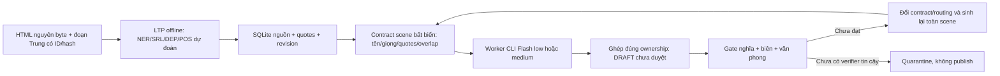

# Route dịch hàng loạt Gemini 3.8 Flash low/medium

> **Phạm vi hiện hành 22/10/2026:** toàn bộ cào–dịch–review–sửa–xuất bản chạy trong Antigravity. Workflow không phụ thuộc nền tảng duyệt ngoài Antigravity. Xem [ANTIGRAVITY_WORKFLOW.md](ANTIGRAVITY_WORKFLOW.md). Draft theo sách có thể được review/promote bằng `review_book_chapter.py`; manifest batch tổng quát bên dưới vẫn chỉ tạo draft và chưa tự publish.

Đây là route nguồn → context → sinh bản dịch theo scene. Các lượt đánh giá mù trong báo cáo pilot là lịch sử thử nghiệm, không phải dịch vụ hoặc bước kiểm định kỳ của workflow. Route hiện tạo draft, **chưa được phép tự công bố chất lượng BNS**. Xem [kết quả thực nghiệm](BATCH_RESULT_20261013.md).

## Nguồn, memory và song song



Nguồn Trung là chuẩn. SQLite chỉ lưu original source và quote, không nhận draft Việt làm sự kiện. Một writer cập nhật nguồn/terminology; worker đọc snapshot cố định. `retain_first_anchor` giữ quote giới thiệu ban đầu và các quote gần nhất, tránh chuyện nhân vật quay lại mà mất quan hệ ban đầu. Retrieval hiện là literal keys + prior quotes, **chưa phải coreference hay graph ngữ nghĩa đã giải**.

State/hash khóa tất cả worker trong block. Mỗi worker chỉ xuất owned ids; overlap nguồn chỉ đọc. Kết quả stale, thiếu/trùng đoạn, đổi glossary hoặc nguồn phải bị chặn. Song song giữa scene độc lập; dialogue/quan hệ phụ thuộc cần scene chung hoặc chạy tuần tự. `scene_end_ids` cung cấp các biên đã xác định theo nguồn. Fallback 32 đoạn là control thử nghiệm, chưa được gọi là tự phát hiện scene.

Native workers được dispatch bằng CLI riêng `--agent novel-batch-worker --model gemini-3.8-flash-low/medium`; init runtime xác nhận từng model. Đây là fan-out worker sessions, **không giả là cây nested invoke_subagent**. Cách này tránh tự suy model low/medium từ tier YAML `inherit/flash/pro`.

## Các lệnh

Chạy trong `I:\Softs\Antigravity\CaoTruyen`. Crawl từng block tối đa 20 chương, chuẩn bị mục lục/lore riêng khi đổi truyện:

```powershell
python -X utf8 native_oauth\crawl_batch_sources.py --from-chapter 1 --to-chapter 3 --out native_oauth\book_job\sources
```

Phân tích bằng môi trường parser đã xác thực:

```powershell
native_oauth\.venv_parser\Scripts\python.exe -X utf8 native_oauth\batch_source_prepass.py --source native_oauth\book_job\sources\source_chapter_0001.json --source native_oauth\book_job\sources\source_chapter_0002.json --source native_oauth\book_job\sources\source_chapter_0003.json --out native_oauth\book_job\analysis
```

LTP không cắt ngầm đoạn vượt cửa sổ. POS idiom cũng chỉ là candidate: trong mẫu thật LTP gộp `不以为然道` thành một token idiom; không được dùng nhãn đó như nghĩa chuẩn.

Lập route v2 với `auto`: medium cho domain/identity polysemy, idiom dự đoán hoặc context bị thiếu vì ngân sách; low cho các scene chưa có những tín hiệu đó. Đây là heuristics bảo thủ, không phải xác suất model đúng. Có thể pin low/medium để benchmark; không tự downgrade khi quota hết.

```powershell
python -X utf8 native_oauth\prepare_batch_route.py --source native_oauth\book_job\sources\source_chapter_0001.json --source native_oauth\book_job\sources\source_chapter_0002.json --source native_oauth\book_job\sources\source_chapter_0003.json --analysis native_oauth\book_job\analysis\chapter_0001.analysis.json --analysis native_oauth\book_job\analysis\chapter_0002.analysis.json --analysis native_oauth\book_job\analysis\chapter_0003.analysis.json --genre hybrid_cyberpunk_tu_tien --book-id 16014 --store native_oauth\book_job\story.sqlite --out native_oauth\book_job\block_0001 --model auto
python -X utf8 native_oauth\batch_run.py --manifest native_oauth\book_job\block_0001\manifest.json
```

`agentic_batch_translator.py --manifest ...` cũng dùng route native này mặc định. API cũ chỉ chạy khi có `--legacy-api`; không tự dùng API key hay model fallback thay cho OAuth low/medium. Entry chương đơn `pipeline_native.py` cũng mặc định Flash low, vẫn dừng ở draft để giữ khả năng kiểm mẫu độc lập.

Muốn tiếp tục một run bị dừng giữa các wave do ngân sách, dùng `--resume`. Cache chỉ được dùng khi candidate/runtime/model/contract/state/hash còn khớp; ghi rõ dùng lại **phiên gốc**, không giả là một phiên sinh mới. Run BLOCKED phải xem nguyên nhân và tạo workspace mới cho retry; không nhận candidate cũ như đầu ra của cuộc gọi mới.

```powershell
python -X utf8 native_oauth\batch_run.py --manifest native_oauth\book_job\block_0001\manifest.json --resume
```

Block sau dùng cùng SQLite và `--through-chapter 3` khi draft block bắt đầu chương 4. Nguồn chương 3 được lấy lại có xác thực để làm predecessor. **Index nguồn/through-chapter ở prepare là progress của source draft, không tự chứng nhận các bản Việt đã duyệt.** Publishing/commit vẫn phải có verifier độc lập. Đã thử ngoại tuyến prepare toàn nguồn chương 1–3 (15 jobs) và continuation chương 4 (5 jobs); không gọi model trong kiểm tra này.

Optional: `--style-evidence` và `--style-ids` để đưa tối đa tám cặp Trung–Việt đã qua gate vào contract làm ví dụ giọng văn. Dùng seed phù hợp truyện/thể loại và khóa một lần; không đưa bản nháp chưa duyệt vào canon. Module kiểm evidence trước sử dụng. Trong pilot, seed là bốn đoạn chương 1 đã duyệt; không phải lời dịch mẫu cho các đoạn đang chấm. Decoder v3 này vẫn chưa giải hết văn phong trong thử nghiệm.

## Sai thì đổi cơ chế, không vá câu

`batch_policy.next_route` trả action, model, scope và số lần thử; không trả câu sửa:

- Context/referent/boundary: mở retrieval từ nguyên văn, hợp nhất dialogue/scene phụ thuộc, đổi state/contract version.
- Nguồn/glossary/state thay đổi: invalidate toàn bộ scene phụ thuộc và các commit sau.
- Nghĩa/đơn vị/thể loại/ngữ pháp: sinh lại **toàn scene từ nguồn**, dùng medium và tuần tự khi cần.
- Sau hai lần thử vẫn chưa đạt: quarantine. Không lấy output thiếu hoặc lời tự chấm PASS làm bản hoàn tất.

Phần implemented: source prepass, store, contract, fan-out, resume, integrity merge và action policy. Phần **chưa implemented/validated đủ để production**: tự giải entity/coreference/scene DAG, typed event ledger, semantic/style checker tin cậy nối vào gate, tự thực thi mọi action hồi phục. `commit_block` mặc định từ chối PASS dict tự khai; cần callback verifier tin cậy. Route không tự xuất TXT production. Audit trong pilot là dữ liệu thử nghiệm lịch sử; vận hành không phụ thuộc một nền tảng review ngoài Antigravity.

## Bước nâng cấp cần làm tiếp theo

Kết quả cho thấy direct translation + prompt bổ sung vẫn có lỗi convert ở cả low và medium. Cần thử kiến trúc tách **source semantic plan → Vietnamese literary decoder → source comparison**. IR phải có speaker/addressee, thái độ đối với phát ngôn nào, loại quan hệ, số/đơn vị, phủ định, thời gian, ownership và quote gốc; dấu bất định không được tự biến thành fact. Plan phải được kiểm nguồn trước khi dùng; không gọi summary AI là chuẩn ngữ nghĩa.

Book canon cần entity ID riêng với chữ tên, alias và relation có valid_from/valid_to; glossary domain-scoped tránh biến người giới thiệu tín dụng thành cấp trên công việc. Narrator/address profile phải có override theo cảnh. Source-backed style seed khác source facts; chưa duyệt thì không ghi thành canon.

Gate tự động cần kiểm đủ nghĩa và văn phong cả scene cùng seam trước/sau, có risk sampling liên tục bằng GPT. Checker được kiểm bằng corpus thật có lược chủ ngữ/alias/delayed reveal; bản hiện tại chủ yếu nêu rõ actor nên chưa chứng minh hiệu quả coreference. Chỉ promote route khi checker bắt được lỗi khóa và rate rerun/quarantine trên unseen books/genres đạt tiêu chí đã đặt trước.

## Ngân sách và bằng chứng

Tối đa hai worker cùng lúc; wrapper chia wave tối đa 16 jobs, source-frozen block tối đa 200 jobs. Timeout mặc định 240s; stop kiểm token giữa wave. Đây **không phải hard realtime token cap**: một call đang chạy có thể vượt cap. Usage thiếu thì dừng, quota/cancel/model mismatch đều không được coi là review hoàn tất. Giữ source/protocol/candidate/runtime và hash; không dump toàn cây parser vào context.

24 worker đã chạy trong pilot, không chạy 10.000 chương. CLI có overhead prompt/tool đáng kể; không ngoại suy chi phí/thông lượng từ một lần đo. Chất lượng BNS ở đây là tiêu chí biên tập tham khảo, không có chứng nhận của BNS. Nghiên cứu repo/primary papers: [context_repo_research.md](batch_benchmark/context_repo_research.md).
